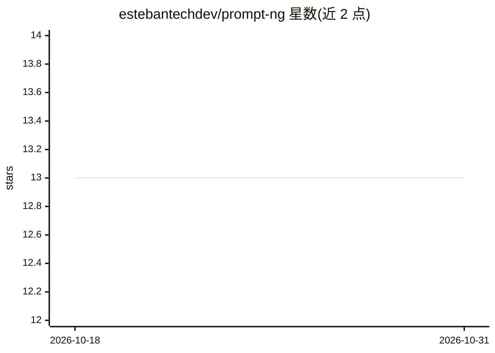

# estebantechdev/prompt-ng

⭐ 13 · Python · GPL-3.0 · 推送 2026-04-14 · [GitHub](https://github.com/estebantechdev/prompt-ng) · 个人维护

**用单条命令组合可复用 AI 提示词组件的 CLI 工具**

Python 编写的模块化命令行工具（命令 pp），将提示词拆为 role、task、pattern、content、controls 等结构化组件：build 用预定义 agent 预设生成提示词，compose 手动组合组件；通过 Jinja2 语法的 --var/--var-file/--var-dir 注入变量，支持文件与目录递归加载，可复制到剪贴板或重定向保存。面向开发者、提示词工程师与 DevOps，用于在项目与流水线中标准化、版本化提示词。不调用模型，仅生成提示词文本。

## 筛选速览

| 维度 | 判定 | 备注 |
|---|---|---|
| AI 角色 | `ai-ecosystem` | LLM/agent 周边工具 |
| 许可风险 | `viral` | GPL-3.0 |
| 部署形态 | `desktop` | 安装包/桌面程序 |
| 模型依赖 | — | README 未给出锁定关系 |
| 硬件要求 | — | 无带数字的原话,不猜 |
| 安装摩擦 | `low` | 无编译、无系统依赖或容器化 |
| 成熟度 | — | 结构信号不足 |

## 能力要点

- build/compose 两种工作流组合 role+task+pattern 等提示词组件
- --var/--var-file/--var-dir 三类变量注入，支持多来源混合与覆盖顺序规则
- 内置 explain 与 action 两种通用任务类型及 agent 预设
- pp list/search/show 管理内置与自定义提示词库

## 适用场景

- 在终端快速生成结构化、可复用的提示词
- 团队将提示词作为版本化组件统一管理与复用
- 在脚本与流水线中嵌入提示词生成步骤

## 场景标签

`提示工程` · 领域:Agent 开发

## 证据(README 行号)

> L37: PromptNG is a modular CLI for composing, managing, and orchestrating reusable AI prompt components.
> L54: * **Developers and AI engineers** building system-driven prompting workflows instead of ad-hoc prompt strings

## 星数曲线

2026-10-18 13 → 2026-10-31 13（+0）

---
*卡片 v1 · prompt 1.4 · 生成 2026-10-31 · 置信度 high · 依据 README sha `61dcbc162f08` · [字段定义](../../DATASET.md)*
