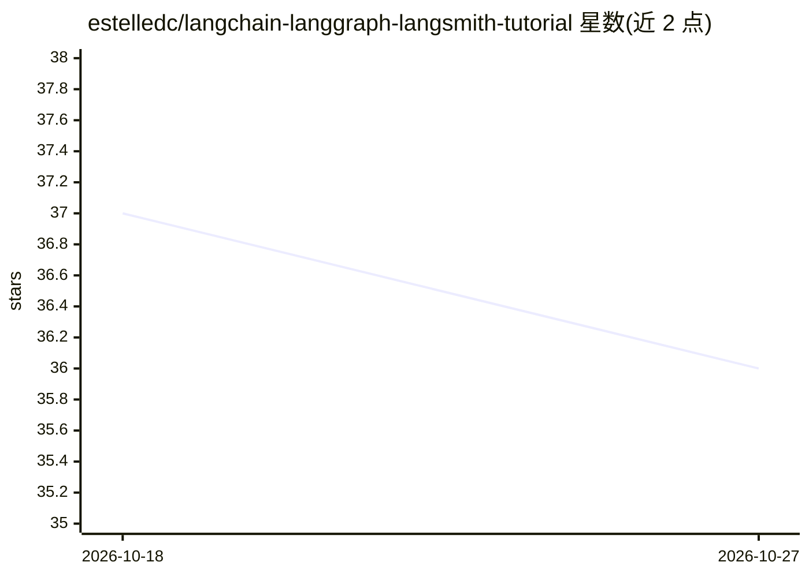

# estelledc/langchain-langgraph-langsmith-tutorial

⭐ 36 · Python · NOASSERTION · 推送 2026-07-28 · [GitHub](https://github.com/estelledc/langchain-langgraph-langsmith-tutorial) · 个人维护 · 中文 README

**Agent 工程实践课程：25 个实验，离线对比 Workflow 与 Agent 框架**

面向学习 Agent 工程的开发者仓库，提供 15 个核心实验与 10 个前沿实验，实验状态由元数据生成。默认路径完全离线、不需要 API Key：以确定性 Workflow 为基线，再逐层引入 LangChain Agent、自定义 LangGraph 与 Deep Agents，在同一数据集上比较复杂度与收益。内置分层评测数据集（capability/regression/adversarial/tool contracts）、确定性 grader 与四态状态标记（PASS/FAIL/UNKNOWN/ERROR），fast suite 含 9 个 case 双实现共 18 次 case-run。V1 版 4 周 16 篇教程冻结在 v1-legacy 分支保留可审计。通过 git clone 与 uv 完成安装运行。

## 筛选速览

| 维度 | 判定 | 备注 |
|---|---|---|
| AI 角色 | `ai-knowledge` | 知识聚合/清单类 |
| 许可风险 | `none` | NOASSERTION |
| 部署形态 | `None` |  |
| 模型依赖 | — | README 未给出锁定关系 |
| 硬件要求 | — | 无带数字的原话,不猜 |
| 安装摩擦 | `low` | 无编译、无系统依赖或容器化 |
| 成熟度 | — | 结构信号不足 |

## 能力要点

- 15 核心实验 + 10 前沿实验，课程由元数据生成
- 默认离线路径，不需要 API Key
- 确定性 grader 覆盖 Final/Attribution/Step/Trajectory/Policy 五层
- fast suite 9 case 双实现共 18 个离线 case-run

## 适用场景

- 系统学习从 Workflow 到 LangGraph 的 Agent 工程演进
- 在同一数据集上对比不同 Agent 框架的成败与成本
- 了解可验证、可恢复 Agent 系统的合同设计与评测口径

## 场景标签

`教程课程` `模型评测` · 领域:评测与运维

## 证据(README 行号)

> L5: 这个仓库不再按 LangChain API 排课。V2 先建立稳定合同，再比较 Workflow、LangChain Agent、LangGraph 和 Deep Agents 的复杂度是否真的换来收益。
> L21: |课程|15 个核心实验 + 10 个前沿实验；状态由元数据生成|

## 星数曲线

2026-10-18 37 → 2026-10-27 36（-1）

---
*卡片 v1 · prompt 1.4 · 生成 2026-10-25 · 置信度 high · 依据 README sha `0f8953eea9af` · [字段定义](../../DATASET.md)*
