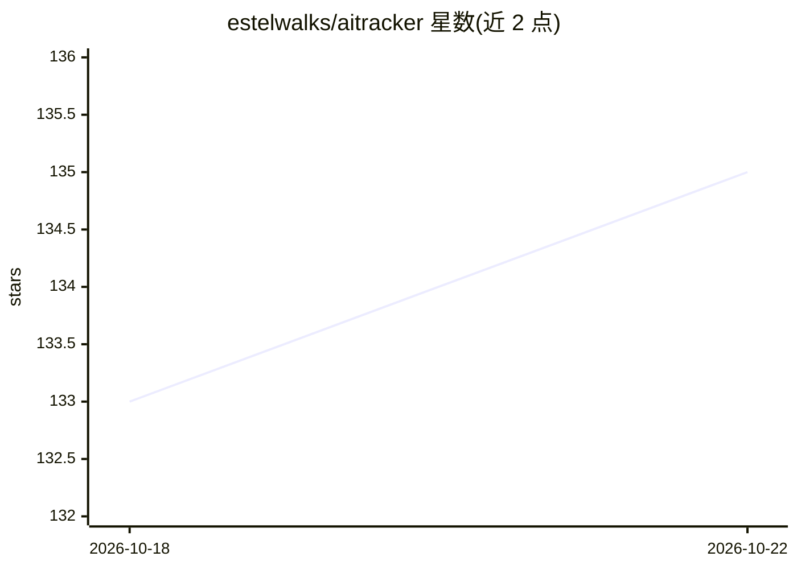

# estelwalks/aitracker

⭐ 135 · TypeScript · NOASSERTION · 推送 2026-10-21 · [GitHub](https://github.com/estelwalks/aitracker) · 个人维护 · 中文 README

**本地优先的 AI 工作台：统计各 AI 编码工具 Token 用量与花费，沉淀 Skills 与长期记忆**

基于 Electron/TanStack Start/React/TypeScript 的桌面应用：自动采集 Claude Code、Codex、Cursor、Cline 等 36+ 种 AI 编码工具在本机的使用数据，聚合 Token、费用、模型与项目消耗趋势到统一 Dashboard；同时自动发现并集中管理分散在各工具的 Skills 与 Rules 配置，从历史会话中提炼可复用 Skills，构建个人知识库与长期记忆。本地优先，核心功能无需账号；Skills Market 与汇率数据来自项目运营的 ai.trusttools.cn 服务。提供 dmg/exe/AppImage/deb/rpm 安装包及 npx、Homebrew、WinGet 安装途径。

## 筛选速览

| 维度 | 判定 | 备注 |
|---|---|---|
| AI 角色 | `ai-ecosystem` | LLM/agent 周边工具 |
| 许可风险 | `none` | NOASSERTION |
| 部署形态 | `desktop` | 安装包/桌面程序 |
| 模型依赖 | — | README 未给出锁定关系 |
| 硬件要求 | — | 无带数字的原话,不猜 |
| 安装摩擦 | `low` | 无编译、无系统依赖或容器化 |
| 成熟度 | — | 结构信号不足 |

## 能力要点

- 自动聚合 36+ 种 AI 编码工具的 Token、费用、模型与项目用量数据
- 自动发现并集中管理分散在各工具的 Skills 与 Rules 配置
- 从真实工作与历史会话提炼可复用 Skills，构建知识库与长期记忆
- 本地优先，核心功能无需账号，数据保留在本机

## 适用场景

- 我想看清自己各 AI 编码工具花了多少钱、用了多少 Token
- 我换 AI 工具时不想重新配置所有 Skills 和 Rules
- 我想把每次 AI 会话中的有效经验沉淀下来复用

## 场景标签

`Agent 记忆` `知识库管理` · 领域:Agent 开发

## 证据(README 行号)

> L15: It automatically tracks tokens, costs, and usage trends across AI tools such as Claude Code, Codex, and Cursor; bri
> L196: |**AI Usage Analytics**|Automatically aggregates tokens, costs, models, projects, and usage trends across AI tools
> L273: It currently covers **data collection and recognition scenarios for 36+ AI tools**, with more being added continuo

## 星数曲线

2026-10-18 133 → 2026-10-22 135（+2）

---
*卡片 v1 · prompt 1.4 · 生成 2026-10-22 · 置信度 high · 依据 README sha `54f024c6a4fb` · [字段定义](../../DATASET.md)*
