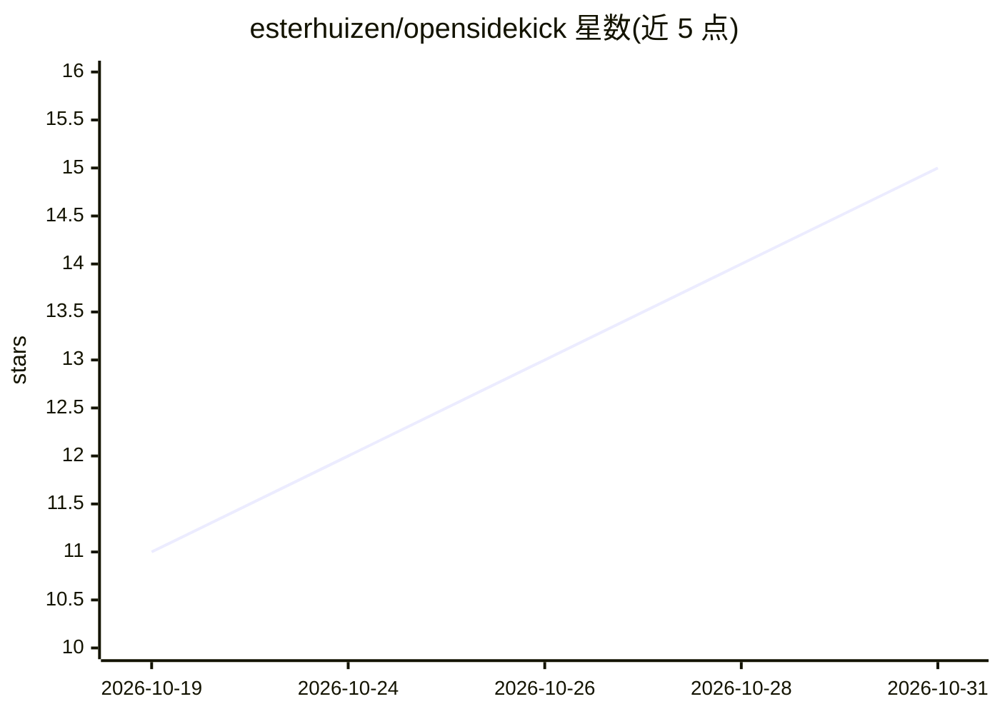

# esterhuizen/opensidekick

⭐ 15 · JavaScript · MIT · 推送 2026-10-27 · [GitHub](https://github.com/esterhuizen/opensidekick) · 个人维护

**供用户自带任意 LLM 的 Chrome 开源浏览器操作 Agent 侧边栏扩展**

MV3 Chrome 扩展，在侧边栏提供感知当前页面的对话与代理式浏览器操作：点击、输入、填表、跨标签页导航，支持视觉截图、多标签管理、定时任务、工作流录制回放，并可通过 MCP 连接外部工具服务器。模型由用户自带，经 OpenAI 兼容协议或 Anthropic Messages API 接入 OpenRouter、OpenAI、Gemini、Groq 或本地 Ollama/LM Studio，密钥仅存于浏览器。内置三档自主模式、站点白名单、敏感站点逐次确认等安全层。MIT 许可，可从 Chrome Web Store 安装或以源码加载。

## 筛选速览

| 维度 | 判定 | 备注 |
|---|---|---|
| AI 角色 | `ai-native` | 本体是模型或模型工具 |
| 许可风险 | `permissive` | MIT |
| 部署形态 | `self-host` | docker 或自建部署 |
| 模型依赖 | local-ok | 支持本地模型 |
| 硬件要求 | — | 无带数字的原话,不猜 |
| 安装摩擦 | `low` | 无编译、无系统依赖或容器化 |
| 成熟度 | — | 结构信号不足 |

## 能力要点

- 代理式页面操作：点击/输入/滚动/拖拽/快捷键，按元素引用执行
- 任意提供商接入：OpenAI 兼容协议与 Anthropic Messages API，含本地 Ollama/LM Studio
- 三档自主模式 + 站点白名单 + 购买/删除类操作强制确认的安全层
- 定时任务、工作流录制回放与 MCP 工具服务器连接

## 适用场景

- 让 AI 代我在网页上填表、点击、跨标签页完成操作
- 用本地 Ollama 模型在浏览器里跑隐私优先的 Agent
- 把重复网页任务录制成工作流后按需回放

## 场景标签

`浏览器自动化` `工作流自动化` · 领域:效率与自动化

## 证据(README 行号)

> L5: **OpenSidekick is an open-source AI agent that lives in Chrome's side panel, reads
> L7: across tabs — using _any_ model you choose.** OpenRouter, OpenAI, Claude, Gemini,
> L53: - **Agentic browser control** — reads an accessible map of the page and clicks,

## 星数曲线

2026-10-19 11 → 2026-10-31 15（+4）

---
*卡片 v1 · prompt 1.4 · 生成 2026-10-31 · 置信度 mid · 依据 README sha `c3941b0cc498` · [字段定义](../../DATASET.md)*
