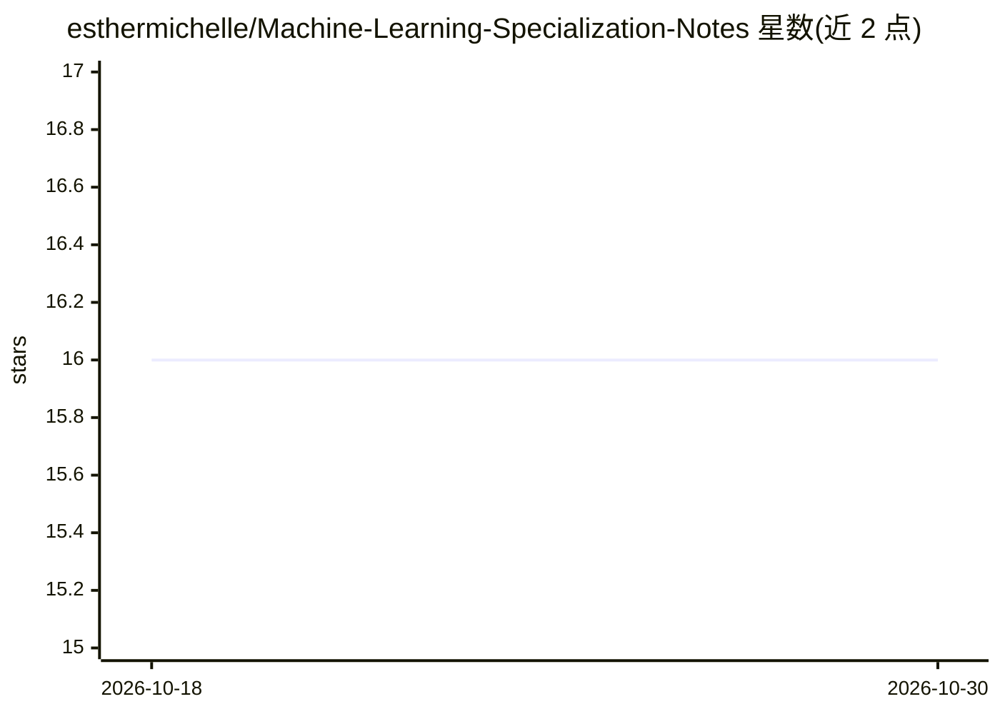

# esthermichelle/Machine-Learning-Specialization-Notes

⭐ 16 · MIT · 推送 2026-08-16 · [GitHub](https://github.com/esthermichelle/Machine-Learning-Specialization-Notes) · 个人维护

**吴恩达机器学习专项课程的个人学习笔记合集**

个人学习笔记仓库，内容基于 DeepLearning.AI 与 Stanford Online 的 Andrew Ng 机器学习专项课程，按主题组织为 12 个章节，覆盖线性回归、梯度下降、逻辑回归、神经网络、决策树、树集成、聚类、异常检测、推荐系统、PCA 与强化学习等基础概念。笔记以 Markdown 形式编写，用途为复习回顾与作为结构化参考资料，作者亦声明用于记录学习过程并服务后续项目。仓库不提供可运行代码或安装方式。

## 筛选速览

| 维度 | 判定 | 备注 |
|---|---|---|
| AI 角色 | `ai-knowledge` | 知识聚合/清单类 |
| 许可风险 | `permissive` | MIT |
| 部署形态 | `None` |  |
| 模型依赖 | — | README 未给出锁定关系 |
| 硬件要求 | — | 无带数字的原话,不猜 |
| 安装摩擦 | `low` | 无编译、无系统依赖或容器化 |
| 成熟度 | — | 结构信号不足 |

## 能力要点

- 覆盖 12 个机器学习基础主题的结构化笔记
- 基于 Andrew Ng 机器学习专项课程（DeepLearning.AI / Stanford Online）
- 以 Markdown 文档形式组织，便于复习与回顾

## 适用场景

- 复习机器学习专项课程的核心概念
- 查找各算法主题的学习笔记作为参考
- 跟随同一课程学习时对照笔记整理思路

## 场景标签

`教程课程` · 领域:学习与行业

## 证据(README 行号)

> L26: These notes are based on Andrew Ng's **Machine Learning Specialization** by DeepLearning.AI and Stanford Online.
> L32: The goal of this repository is to document my learning journey through Machine Learning concepts and provide a stru

## 星数曲线

2026-10-18 16 → 2026-10-30 16（+0）

---
*卡片 v1 · prompt 1.4 · 生成 2026-10-30 · 置信度 high · 依据 README sha `2efacc0791ef` · [字段定义](../../DATASET.md)*
