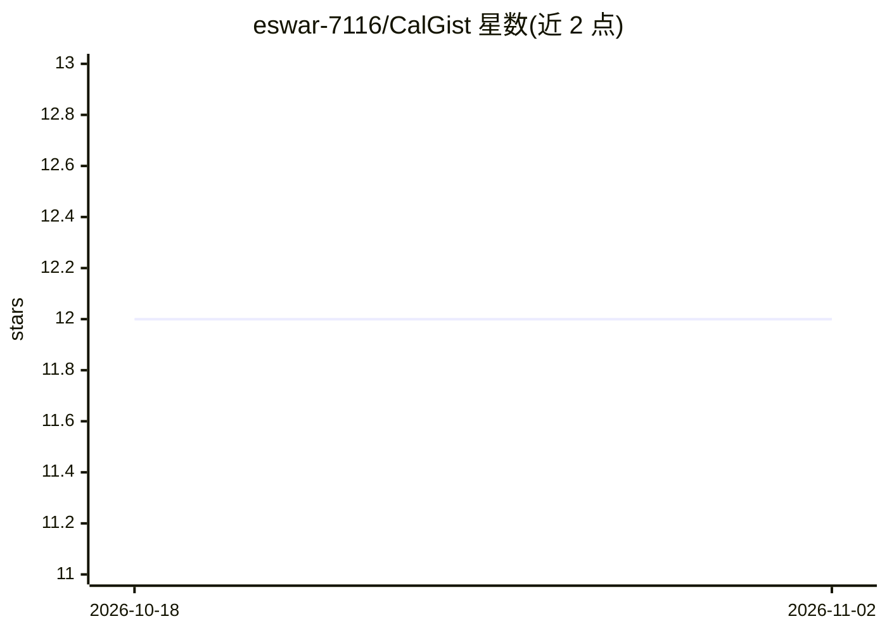

# eswar-7116/CalGist

⭐ 12 · TypeScript · MIT · 推送 2025-12-14 · [GitHub](https://github.com/eswar-7116/CalGist) · [官网](https://cal-gist.vercel.app) · 个人维护

**面向个人用户的 Google Calendar AI 事件摘要工具**

基于 Next.js + TypeScript 构建的日历摘要助手：通过 Supabase Auth 完成注册登录，接入 Google Calendar API 获取即将到来的日程，调用 Google Gemini API 为每个事件生成简明摘要，并在仪表盘中展示事件与摘要，支持重新生成摘要和一键复制。技术栈含 Supabase（认证+数据库）、Tailwind CSS + ShadCN UI，文档标注可部署到 Vercel。本地运行需 git clone 源码并配置 Supabase 与 Gemini 等环境变量。

## 筛选速览

| 维度 | 判定 | 备注 |
|---|---|---|
| AI 角色 | `ai-native` | 本体是模型或模型工具 |
| 许可风险 | `permissive` | MIT |
| 部署形态 | `None` |  |
| 模型依赖 | — | README 未给出锁定关系 |
| 硬件要求 | — | 无带数字的原话,不猜 |
| 安装摩擦 | `low` | 无编译、无系统依赖或容器化 |
| 成熟度 | — | 结构信号不足 |

## 能力要点

- Google OAuth 接入并同步获取即将到来的日程事件
- 调用 Google Gemini API 为每个事件生成摘要
- Supabase Auth 用户认证与数据库存储
- 支持摘要重新生成与一键复制

## 适用场景

- 查看未来日程并获得每个事件的 AI 摘要
- 在统一仪表盘中管理日历事件与摘要
- 复制摘要用于分享或记录

## 场景标签

`AI 助手` · 领域:对话与助手

## 证据(README 行号)

> L3: CalGist is an event summarizing assistant that connects with your Google Calendar, generates helpful AI summaries fo
> L19:  Uses Gemini (Google AI) to generate smart, concise summaries for each event.

## 星数曲线

2026-10-18 12 → 2026-11-02 12（+0）

---
*卡片 v1 · prompt 1.4 · 生成 2026-11-01 · 置信度 high · 依据 README sha `6b87bf69d1e6` · [字段定义](../../DATASET.md)*
