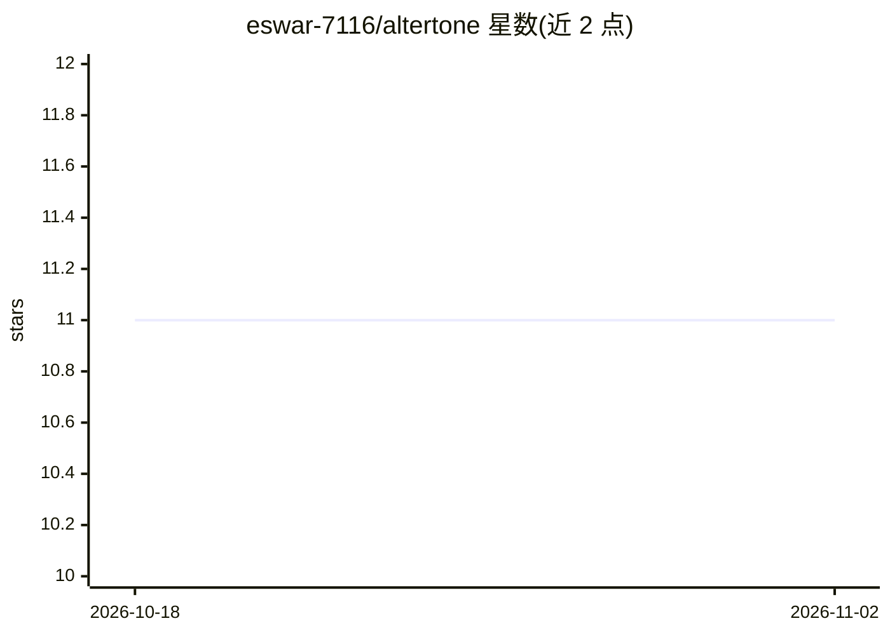

# eswar-7116/altertone

⭐ 11 · TypeScript · MIT · 推送 2025-12-14 · [GitHub](https://github.com/eswar-7116/altertone) · [官网](https://altertone-two.vercel.app) · 个人维护

**面向普通用户的文本语气检测与改写 Web 工具**

基于 Next.js 14 的 Web 应用：用户输入一段文本，选择 20+ 种目标语气（专业、休闲、浪漫、讽刺等），调节创造力参数（0-100%），调用 Google Gemini 2.0 Flash API 将文本转换为对应语气后输出。面向需要调整邮件、社交媒体文案、客服话术或个人消息语气的终端用户，无需注册账号，声明不存储数据。自部署需 Node.js 与自备 Gemini API key，通过 git clone 与 npm 安装运行；另有在线 Demo（Vercel 部署）。

## 筛选速览

| 维度 | 判定 | 备注 |
|---|---|---|
| AI 角色 | `ai-native` | 本体是模型或模型工具 |
| 许可风险 | `permissive` | MIT |
| 部署形态 | `library` | 以包/库形式分发 |
| 模型依赖 | — | README 未给出锁定关系 |
| 硬件要求 | — | 无带数字的原话,不猜 |
| 安装摩擦 | `low` | 无编译、无系统依赖或容器化 |
| 成熟度 | — | 结构信号不足 |

## 能力要点

- 检测并转换文本到 20+ 种语气
- 创造力参数 0-100% 可调
- 无需注册账号，声明不存储或跟踪数据
- 提供在线 Demo，亦可本地部署（Node.js + Gemini API key）

## 适用场景

- 把邮件改写成更专业的语气
- 为社交媒体内容匹配品牌语气
- 写个人消息时调整为浪漫或友好的表达

## 场景标签

`AI 写作` · 领域:内容生成

## 证据(README 行号)

> L9: AlterTone is a powerful tone transformation tool that detects and converts your text into 20+ different tones using 
> L46: - **AI Engine**: Google Gemini 2.0 Flash API

## 星数曲线

2026-10-18 11 → 2026-11-02 11（+0）

---
*卡片 v1 · prompt 1.4 · 生成 2026-11-02 · 置信度 high · 依据 README sha `4ab8623e3995` · [字段定义](../../DATASET.md)*
