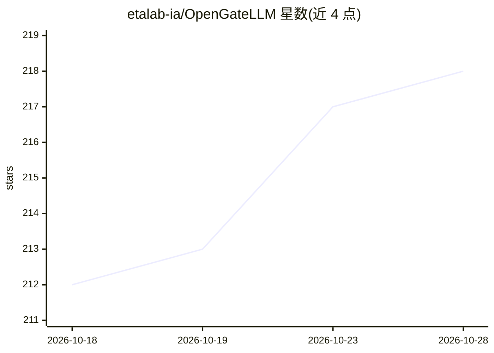

# etalab-ia/OpenGateLLM

⭐ 218 · Python · MIT · 推送 2026-10-27 · [GitHub](https://github.com/etalab-ia/OpenGateLLM) · 组织维护

**面向自托管 LLM 的统一 API 网关：集中接入、安全与治理**

OpenGateLLM 是一个开源的生成式 AI API 网关，定位为面向组织的自托管模型接入层：集中管理对 AI 模型的访问，提供访问控制、不存储聊天记录的安全策略，并通过 OpenAI 兼容 API 与 GenAI 生态框架集成。核心场景是数据主权与成本控制：以自托管模型替代商业 API，无厂商锁定。自称是 LiteLLM、TensorZero、OpenRouter 的替代品（专用于自托管基础设施）。当前处于 beta 阶段，可能出现重大破坏性变更。项目由 DINUM 与 CentraleSupélec 赞助。

## 筛选速览

| 维度 | 判定 | 备注 |
|---|---|---|
| AI 角色 | `ai-ecosystem` | LLM/agent 周边工具 |
| 许可风险 | `permissive` | MIT |
| 部署形态 | `None` |  |
| 模型依赖 | — | README 未给出锁定关系 |
| 硬件要求 | — | 无带数字的原话,不猜 |
| 安装摩擦 | `low` | 无编译、无系统依赖或容器化 |
| 成熟度 | `idea` | |

## 能力要点

- OpenAI 兼容 API 与 GenAI 生态框架集成
- 组织级访问控制与治理，不存储聊天记录
- 面向自托管模型优化，声明无厂商锁定
- 全部功能免费开源，无商业许可限制

## 适用场景

- 为组织内多个团队统一接入与治理自托管 LLM
- 控制商业 API 与 GPU 基础设施支出
- 满足数据主权与隐私要求地部署生成式 AI

## 场景标签

`模型网关` · 领域:Agent 开发

## 证据(README 行号)

> L14: OpenGateLLM is an open-source , production-ready API gateway for Generative AI.
> L21: > **OpenGateLLM, as API gateway, is an alternative to LiteLLM, TensorZero, OpenRouter and others, dedicated to self

## 星数曲线

2026-10-18 212 → 2026-10-28 218（+6）

---
*卡片 v1 · prompt 1.4 · 生成 2026-10-23 · 置信度 high · 依据 README sha `989c32012de7` · [字段定义](../../DATASET.md)*
