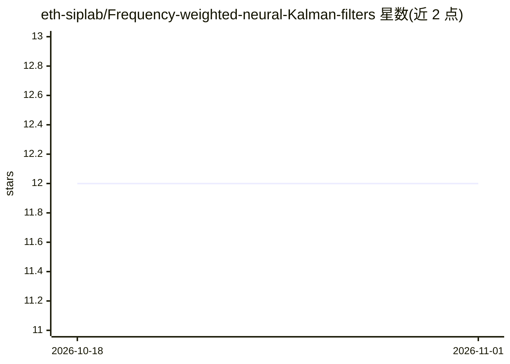

# eth-siplab/Frequency-weighted-neural-Kalman-filters

⭐ 12 · Python · MIT · 推送 2026-03-05 · [GitHub](https://github.com/eth-siplab/Frequency-weighted-neural-Kalman-filters) · 组织维护

**面向科研的频域加权神经卡尔曼滤波器官方实现**

论文 FW-NKF（ICRA 2026）的官方 PyTorch 实现：在卡尔曼滤波的创新序列上引入可学习 IIR 滤波器，配合频谱监督，在频率局部化传感器噪声下进行状态估计。代码库提供 7 种模型（含 KalmanNet 等基线）、4 个数据集（Lorenz、单摆、UWB-IMU 人体姿态、EuRoC MAV）、训练/评估/指标聚合与运行时基准脚本，并给出复现论文全部实验的命令与预训练 checkpoint 下载。MIT 许可。

## 筛选速览

| 维度 | 判定 | 备注 |
|---|---|---|
| AI 角色 | `ai-native` | 本体是模型或模型工具 |
| 许可风险 | `permissive` | MIT |
| 部署形态 | `library` | 以包/库形式分发 |
| 模型依赖 | — | README 未给出锁定关系 |
| 硬件要求 | — | 无带数字的原话,不猜 |
| 安装摩擦 | `medium` | 含编译或系统依赖之一 |
| 成熟度 | — | 结构信号不足 |

## 能力要点

- 可学习 IIR 滤波作用于卡尔曼创新序列，配合频谱监督
- 内置 7 种模型与 4 个数据集（合成+真实 UWB-IMU/EuRoC）
- 提供复现论文实验的完整命令、3 种子结果与 checkpoint 下载
- 训练结束后自动输出 MSE/RMSE/MAE/NRMSE/R2 指标

## 适用场景

- 复现论文中 FW-NKF 与各基线的状态估计结果
- 在自定义噪声场景下训练与对比神经卡尔曼滤波模型
- 基准测试各模型的推理速度与参数量

## 场景标签

`科研工具` · 领域:学习与行业

## 证据(README 行号)

> L7: **Overview of FW-NKF with spectral supervision.** **(a)** The observation model *H(·)* predicts sensor measurements 
> L23: |`deep_kf`|**FW-NKF** (proposed)|This work|

## 星数曲线

2026-10-18 12 → 2026-11-01 12（+0）

---
*卡片 v1 · prompt 1.4 · 生成 2026-11-01 · 置信度 mid · 依据 README sha `7d8453a9bf37` · [字段定义](../../DATASET.md)*
