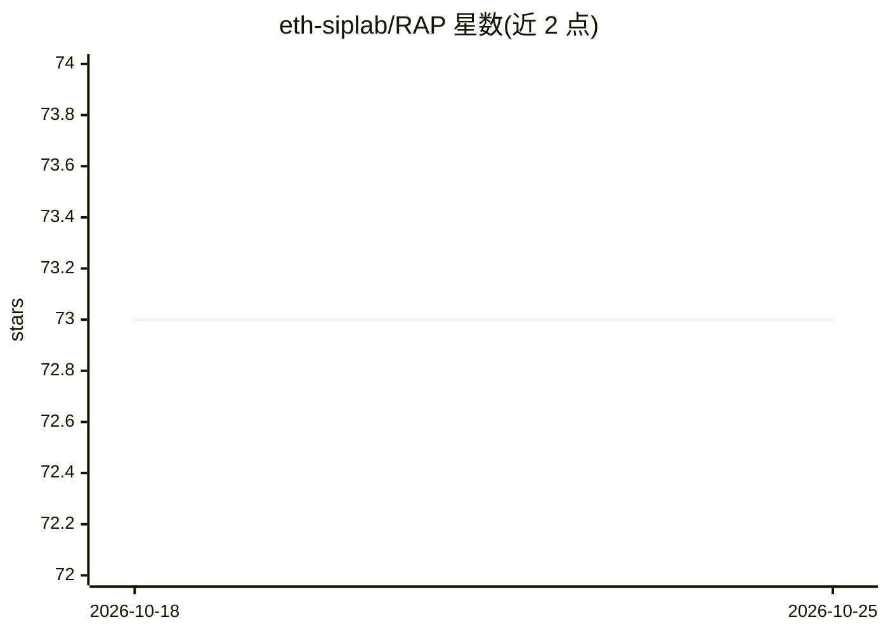

# eth-siplab/RAP

⭐ 73 · Python · Apache-2.0 · 推送 2026-09-29 · [GitHub](https://github.com/eth-siplab/RAP) · [官网](https://arxiv.org/abs/2305.13093) · 组织维护

**本地图像修复 Web 应用：按区域分割后各配专属修复模型**

苏黎世联邦理工学院 SIPLab 的本地图像修复编辑器：用 SAM 3 按点击、框选、笔刷或名称（face/sky/text）选中照片区域，为每个区域分配不同模型——修复（PiSA-SR）、去噪（SCUNet/DRUNet）、去模糊（NAFNet）、JPEG 修复（FBCNN）、人脸修复（CodeFormer）、物体移除（LaMa/ObjectClear）、生成填充（FLUX.2 klein）、上色（DDColor）、低光（HVI-CIDNet）等，模型主控预渲染使滑块即时响应。以 conda + setup.sh 脚本源码安装，需 NVIDIA GPU（8GB 起可运行全部功能，推荐 32GB 内存），FastAPI 后端 + 浏览器界面。CodeFormer/ObjectClear 为非商业许可。

## 筛选速览

| 维度 | 判定 | 备注 |
|---|---|---|
| AI 角色 | `ai-native` | 本体是模型或模型工具 |
| 许可风险 | `permissive` | Apache-2.0 |
| 部署形态 | `library` | 以包/库形式分发 |
| 模型依赖 | — | README 未给出锁定关系 |
| 硬件要求 | — | 无带数字的原话,不猜 |
| 安装摩擦 | `medium` | 含编译或系统依赖之一 |
| 成熟度 | — | 结构信号不足 |

## 能力要点

- SAM 3 区域选择（点击/框选/笔刷/文本提示）+ 每区域独立模型与强度
- 内置 10 个修复模型，可子类化 Restorer 一类代码新增模型
- 控制预渲染 + filmstrip 预览，滑块即时反馈
- 按 GPU 显存自适应加载（8GB 起），导出支持 2×/4× AI 放大

## 适用场景

- 修复老照片、去噪去模糊、清理 JPEG 伪影
- 按区域精修人像：修脸、背景虚化、低光提亮
- 移除物体连同阴影，或用提示词生成替换背景

## 场景标签

`图像视频处理` · 领域:感知与多模态

## 证据(README 行号)

> L20: select each part with SAM 3 and
> L30: - 🧰 **One model per region.** Restore, denoise, deblur, fix JPEG, restore faces, colorize, brighten, erase, remove 
> L104: python -m rap --gpu 0 --port 7860

## 星数曲线

2026-10-18 73 → 2026-10-25 73（+0）

---
*卡片 v1 · prompt 1.4 · 生成 2026-10-24 · 置信度 mid · 依据 README sha `7bcce453245e` · [字段定义](../../DATASET.md)*
