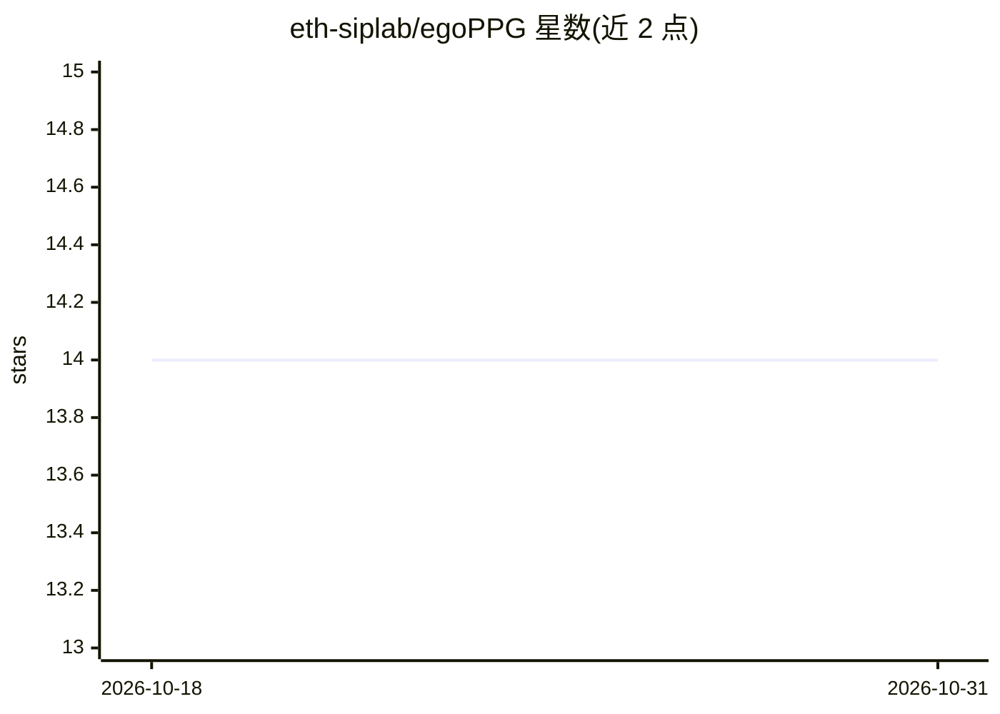

# eth-siplab/egoPPG

⭐ 14 · Python · 推送 2026-03-20 · [GitHub](https://github.com/eth-siplab/egoPPG) · [官网](https://siplab.org/projects/egoPPG) · 组织维护

**ICCV 2025 论文官方代码：从眼动追踪相机估计心率**

ETH Zürich 团队发布的 ICCV 2025 论文官方实现：提出 egoPPG 任务与 PulseFormer 模型，从眼周区域视频恢复 PPG 信号并结合头显 IMU 运动线索连续估计心率，下游用于 EgoExo4D 熟练度估计（论文报告提升 14%）。配套 egoPPG-DB 数据集（13+ 小时、25 名参与者、约 220GB），需签署 DTUA 协议且仅限非商业学术研究，由机构成员签署。提供 conda 环境搭建、预处理与训练/推理脚本；下游熟练度估计代码标注 'Code will be up soon'。训练与推理使用一块 GeForce RTX 4090 GPU。

## 筛选速览

| 维度 | 判定 | 备注 |
|---|---|---|
| AI 角色 | `ai-native` | 本体是模型或模型工具 |
| 许可风险 | `none` | — |
| 部署形态 | `None` |  |
| 模型依赖 | — | README 未给出锁定关系 |
| 硬件要求 | — | 无带数字的原话,不猜 |
| 安装摩擦 | `low` | 无编译、无系统依赖或容器化 |
| 成熟度 | — | 结构信号不足 |

## 能力要点

- PulseFormer 从眼动视频恢复 PPG 并融合 IMU 运动线索估计心率
- 配套 egoPPG-DB 数据集：13+ 小时眼动视频、25 名参与者、44–164 bpm
- 支持接入新模型与新数据集的扩展流程（模型/训练器/配置文件模板）
- 多种 rPPG 基线模型（PhysFormer、PhysNet、TS-CAN、DeepPhys 等）可在同一框架内训练评估

## 适用场景

- 复现论文中的眼动视频心率估计实验
- 在同一框架下对比不同 rPPG 模型在我的眼动数据上的表现
- 研究自我中心视角系统中生理信号对下游视觉任务的增益

## 场景标签

 · 领域:计算机视觉/生理计算

## 证据(README 行号)

> L9: *egoPPG* is a novel vision task for egocentric systems to recover a person’s cardiac activity to aid downstream visi
> L10: Our method, *PulseFormer* continuously estimates the person’s photoplethysmogram (PPG) from areas around the eyes a

## 星数曲线

2026-10-18 14 → 2026-10-31 14（+0）

---
*卡片 v1 · prompt 1.4 · 生成 2026-10-31 · 置信度 high · 依据 README sha `7fb14a581a04` · [字段定义](../../DATASET.md)*
