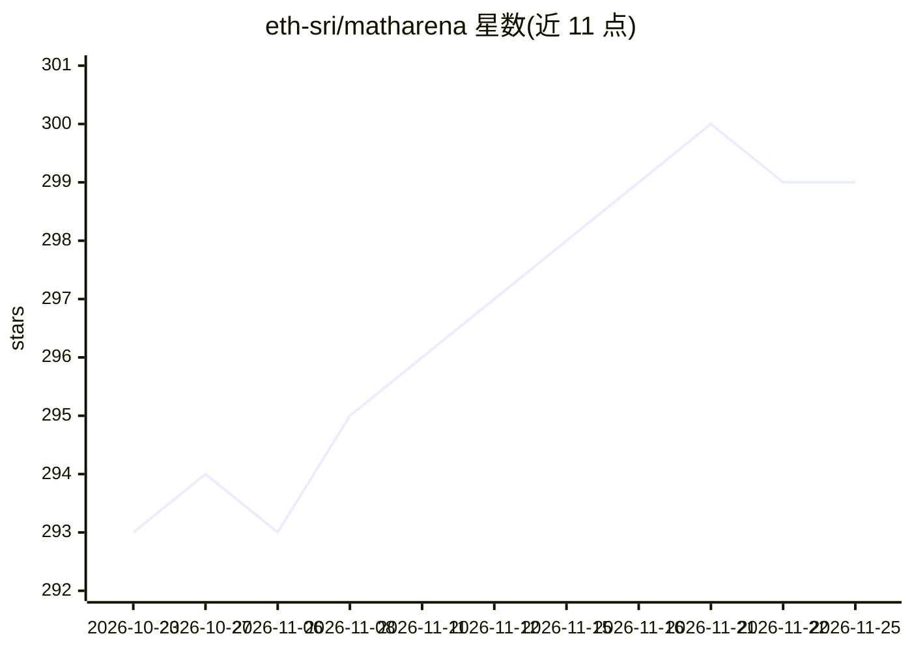

# eth-sri/matharena

⭐ 299 · Python · MIT · 推送 2026-11-09 · [GitHub](https://github.com/eth-sri/matharena) · [官网](https://matharena.ai) · 组织维护

**在最新数学竞赛与奥赛上评测 LLM 的平台**

MathArena 是一个对 LLM 在最新数学竞赛与奥赛题目上进行评测的平台（NeurIPS D&B '25 论文），托管于 matharena.ai；本仓库包含模型评测的全部代码。用户通过 YAML 配置文件添加模型与竞赛，用 uv 运行评测脚本，支持按题目数量、重跑、容器后端等参数控制；需要判分的竞赛单独运行 judge 脚本，结果通过本地 Web 服务器（Flask 端口 5001）查看，包含模型完整交互轨迹与警告标记。评测日志与推理轨迹发布在 HuggingFace 页面。

## 筛选速览

| 维度 | 判定 | 备注 |
|---|---|---|
| AI 角色 | `ai-ecosystem` | LLM/agent 周边工具 |
| 许可风险 | `permissive` | MIT |
| 部署形态 | `library` | 以包/库形式分发 |
| 模型依赖 | local-ok | 支持本地模型 |
| 硬件要求 | — | 无带数字的原话,不猜 |
| 安装摩擦 | `low` | 无编译、无系统依赖或容器化 |
| 成熟度 | — | 结构信号不足 |

## 能力要点

- 支持 AIME、HMMT、IMO、Putnam 等 20+ 竞赛配置，含 ArXivMath/ArXivLean 与 Visual Math
- 模型经 YAML 配置接入，支持 xai/openai/anthropic/google/deepseek/vllm 等多种 API
- 可通过 codex/claude/kimi 等 harness CLI 运行 agent 型评测
- 本地 Web 服务器展示最终答案、完整模型交互与解析警告标记

## 适用场景

- 在新发布的数学竞赛题上复现 LLM 评测结果
- 将自选模型或 agent 接入统一评测流程对比得分
- 在本地查看模型答题的完整推理轨迹与判分细节

## 场景标签

`模型评测` · 领域:评测与运维

## 证据(README 行号)

> L15: MathArena (NeurIPS D&B '25) is a platform for evaluation of LLMs on latest math competitions and olympiads. It is h
> L50: Execute the following command to evaluate a model on a competition:
> L149:  - `api`: API provider. The API key should be defined as an environment variable when using the specified API. The

## 星数曲线

2026-10-23 293 → 2026-11-25 299（+6）

---
*卡片 v1 · prompt 1.4 · 生成 2026-11-25 · 置信度 high · 依据 README sha `d8dd3be43cae` · [字段定义](../../DATASET.md)*
