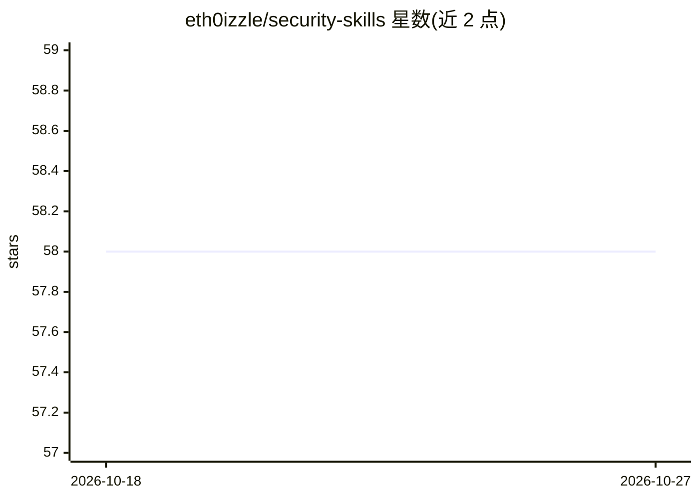

# eth0izzle/security-skills

⭐ 58 · Python · MIT · 推送 2026-04-27 · [GitHub](https://github.com/eth0izzle/security-skills) · [官网](https://darkport.co.uk) · 个人维护

**面向 Claude Code 的安全运维技能插件合集（SOAR/SIEM）**

由个人维护的 Claude Code 技能插件市场：当前含 2 个技能，分别对接 CrowdStrike Falcon Fusion SOAR（工作流创建/验证/导入/执行/导出、YAML 编写、CEL 表达式处理）与 Falcon Next-Gen SIEM（CSV/JSON/TXT 查找文件的增删改查与 FQL 搜索）。通过 /plugin 命令或手动 git clone 安装到 ~/.claude/plugins/；部分技能需配置 CrowdStrike API key 才能访问真实环境。

## 筛选速览

| 维度 | 判定 | 备注 |
|---|---|---|
| AI 角色 | `ai-knowledge` | 知识聚合/清单类 |
| 许可风险 | `permissive` | MIT |
| 部署形态 | `None` |  |
| 模型依赖 | locked-api |  |
| 硬件要求 | — | 无带数字的原话,不猜 |
| 安装摩擦 | `low` | 无编译、无系统依赖或容器化 |
| 成熟度 | — | 结构信号不足 |

## 能力要点

- fusion-workflows 技能通过实时 API 发现 Falcon Fusion 动作并管理 SOAR 工作流全生命周期
- lookup-files 技能支持 CSV/JSON/TXT 查找文件管理与 CQL/FQL 查询
- 支持插件市场一键安装或手动 git clone 安装
- 每个技能含 SKILL.md、scripts/、references/、assets/ 结构

## 适用场景

- 安全团队用自然语言让 Claude 自动化 CrowdStrike 平台运维
- 自动生成符合 schema 的 SOAR 工作流 YAML
- 管理 Next-Gen SIEM 查找文件辅助威胁检测查询

## 场景标签

`网络安全` · 领域:学习与行业

## 证据(README 行号)

> L3: A plugin marketplace of Claude Code skills that automate security operations.
> L9: |Skill|Platform|What It Does|

## 星数曲线

2026-10-18 58 → 2026-10-27 58（+0）

---
*卡片 v1 · prompt 1.4 · 生成 2026-10-24 · 置信度 high · 依据 README sha `ca947393804e` · [字段定义](../../DATASET.md)*
