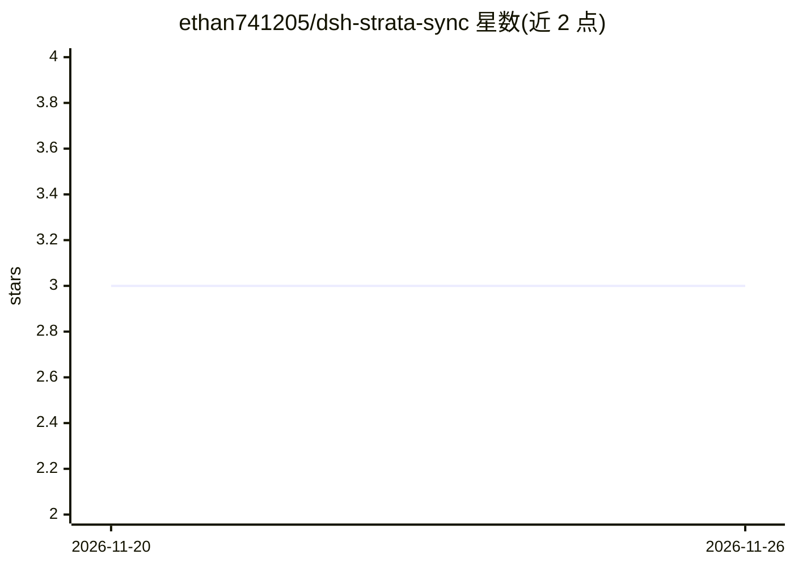

# ethan741205/dsh-strata-sync

⭐ 3 · JavaScript · MIT · 推送 2026-11-05 · [GitHub](https://github.com/ethan741205/dsh-strata-sync) · 个人维护

**DSH 插件：同步 Strata Server 模型上下文与压缩预算**

面向 DSH（DeepSeek Harness）用户的插件，将 DSH 连接到 Strata Server 中已加载的模型：读取模型信息、预览差异，更新 DSH 的自定义模型条目、上下文窗口与压缩预算，并为支持的摘要请求附加可编辑的长度指令。对 Strata Server 只读，不切换/加载服务端模型、不改服务端设置、不发送额外推理请求。安装方式为 DSH 插件管理器或官方 CLI；启动同步开关默认关闭。

## 筛选速览

| 维度 | 判定 | 备注 |
|---|---|---|
| AI 角色 | `ai-ecosystem` | LLM/agent 周边工具 |
| 许可风险 | `permissive` | MIT |
| 部署形态 | `None` |  |
| 模型依赖 | — | README 未给出锁定关系 |
| 硬件要求 | — | 无带数字的原话,不猜 |
| 安装摩擦 | `low` | 无编译、无系统依赖或容器化 |
| 成熟度 | — | 结构信号不足 |

## 能力要点

- 同步模型设置：上下文窗口、输出上限、输入类型与推理级别
- 对齐 DSH Agent 预设中的压缩预算策略
- 可编辑的摘要长度指令与两个目标长度比例参数
- 差异预览、设置备份与最近一次同步结果查看

## 适用场景

- 在 Strata Server 中更换模型后同步 DSH 配置
- 统一管理 DSH 会话的上下文与压缩预算
- 控制会话检查点摘要的长度与格式

## 场景标签

 · 领域:LLM 基础设施/工具链

## 证据(README 行号)

> L5: Connect **DeepSeek Harness (DSH)** to the model loaded in **Strata Server**, with model settings and summary control
> L7: The plugin reads Strata's model information, previews the changes, and updates DSH's custom model and context-compac
> L12: - **Align compaction budgets:** update the matching policies in enabled DSH Agent presets.

## 星数曲线

2026-11-20 3 → 2026-11-26 3（+0）

---
*卡片 v1 · prompt 1.4 · 生成 2026-11-22 · 置信度 high · 依据 README sha `e1ff842fe410` · [字段定义](../../DATASET.md)*
