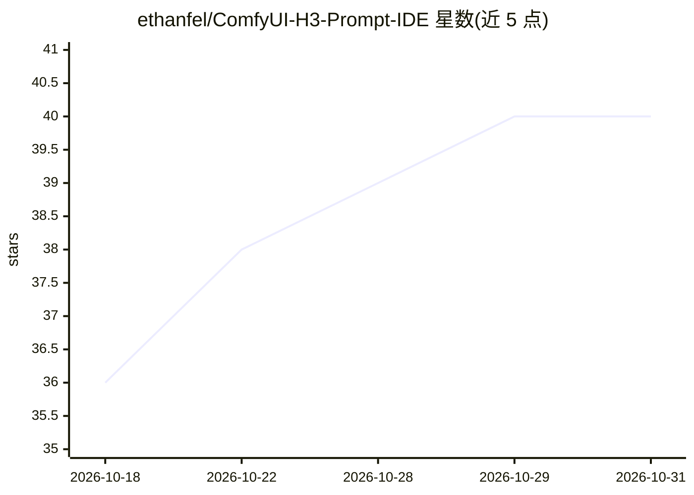

# ethanfel/ComfyUI-H3-Prompt-IDE

⭐ 40 · JavaScript · GPL-3.0 · 推送 2026-09-23 · [GitHub](https://github.com/ethanfel/ComfyUI-H3-Prompt-IDE) · 个人维护

**ComfyUI 中 MiniMax H3 提示词的富文本编辑器节点**

ComfyUI 自定义节点，受 VS Code 启发，为 MiniMax H3 提供提示词编写环境：严格的 H3 分节、补全、引用预览（图片/视频帧/音频）、参考与说话人 token 点击替换、诊断校验，最终输出普通 ComfyUI STRING。深度对接 H3 Edit 编码器（0.10.0/0.11.0），随任务切换（编辑指令、重摆姿势、角色替换、运镜等）联动更新；不包含 Motion Context @tag 编译。通过 git clone 到 custom_nodes 安装，需带 V3 node API 与 Autogrow 支持的 ComfyUI 版本；正确的单 token 编码需含 PR #15808 的 ComfyUI 构建。

## 筛选速览

| 维度 | 判定 | 备注 |
|---|---|---|
| AI 角色 | `ai-ecosystem` | LLM/agent 周边工具 |
| 许可风险 | `viral` | GPL-3.0 |
| 部署形态 | `None` |  |
| 模型依赖 | — | README 未给出锁定关系 |
| 硬件要求 | — | 无带数字的原话,不猜 |
| 安装摩擦 | `low` | 无编译、无系统依赖或容器化 |
| 成熟度 | — | 结构信号不足 |

## 能力要点

- H3 感知的补全、引用 token 替换与多 schema（T2VA/I2VA/FL2VA/L2VA/Ref2VA）校验
- 随 H3 Edit 编码器任务/模式实时联动并加载任务起始指令模板
- H3 Reference Inputs 节点自动扩展图像/视频/音频引用槽位并提供预览
- 提供版本化嵌入 API，供其他本地扩展在对话框中挂载同一编辑器

## 适用场景

- 在 ComfyUI 中为 MiniMax H3 编写带引用标注的结构化提示词
- 做 H3 Edit 指令类任务（重摆姿势、角色替换、运镜、连续定格场景等）的提示词编写
- 其他 ComfyUI 扩展复用该编辑器组件

## 场景标签

`提示工程` · 领域:Agent 开发

## 证据(README 行号)

> L5: A VS Code-inspired prompt editor for MiniMax H3. It provides rich editing, strict H3 sections, completions, referenc
> L74: - **H3 Prompt IDE** — rich editor with a Plain/Rich source toggle, T2VA, I2VA, FL2VA, L2VA, Ref2VA, and downstream 

## 星数曲线

2026-10-18 36 → 2026-10-31 40（+4）

---
*卡片 v1 · prompt 1.4 · 生成 2026-10-25 · 置信度 high · 依据 README sha `32693ab14763` · [字段定义](../../DATASET.md)*
