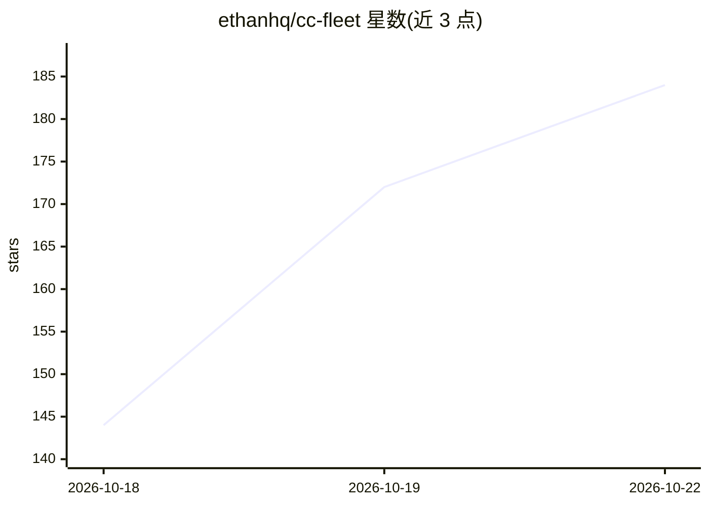

# ethanhq/cc-fleet

⭐ 184 · Go · Apache-2.0 · 推送 2026-10-21 · [GitHub](https://github.com/ethanhq/cc-fleet) · 个人维护 · 中文 README

**让 Claude Code 的工作流/团队/子代理接入任意第三方模型**

面向 Claude Code 用户的 CLI 工具：把任意 Anthropic 或 OpenAI 兼容 API 的模型（DeepSeek、GLM、Kimi、Qwen 或 Codex 订阅）接入 Claude Code 的 Dynamic Workflows、Agent Teams 与 Subagents，每个 worker 是替换了 LLM 后端的真实 claude 进程。主会话认证不受影响，provider key 不进入 env/argv/shell history。提供 TUI 面板查看任务、提示词与花费，工作流支持预算控制、断点重放。Agent Teams 需 tmux/iTerm2 且暂不支持 Windows。

## 筛选速览

| 维度 | 判定 | 备注 |
|---|---|---|
| AI 角色 | `ai-ecosystem` | LLM/agent 周边工具 |
| 许可风险 | `permissive` | Apache-2.0 |
| 部署形态 | `library` | 以包/库形式分发 |
| 模型依赖 | — | README 未给出锁定关系 |
| 硬件要求 | — | 无带数字的原话,不猜 |
| 安装摩擦 | `low` | 无编译、无系统依赖或容器化 |
| 成熟度 | — | 结构信号不足 |

## 能力要点

- 第三方模型作为 workflow 叶节点/常驻队友/一次性子代理参与编排
- ccf run 在任意 provider 上启动交互式 claude 会话，无需 Anthropic 订阅
- provider key 不进 env/argv/shell history，主会话认证不受影响
- TUI Agents Board 展示运行树、队友收件箱与花费；工作流支持 USD/token 预算与断点重放

## 适用场景

- 在 Claude Code 中用 DeepSeek/GLM/Kimi/Qwen 等模型跑多代理工作流
- 组建混合多家 provider 的 agent 团队并排对比结果
- 无 Anthropic 订阅时用自有 API key 运行完整 Claude Code

## 场景标签

 · 领域:LLM 基础设施/agent 编排

## 证据(README 行号)

> L11: Claude Code's multi-agent orchestration — Dynamic Workflows, Agent Teams, Subagents — only runs Anthropic's own mod
> L13: Every third-party worker is a real `claude` process with its LLM backend swapped to the provider, so Claude Code dr

## 星数曲线

2026-10-18 144 → 2026-10-22 184（+40）

---
*卡片 v1 · prompt 1.4 · 生成 2026-10-22 · 置信度 high · 依据 README sha `baea5787e6a8` · [字段定义](../../DATASET.md)*
