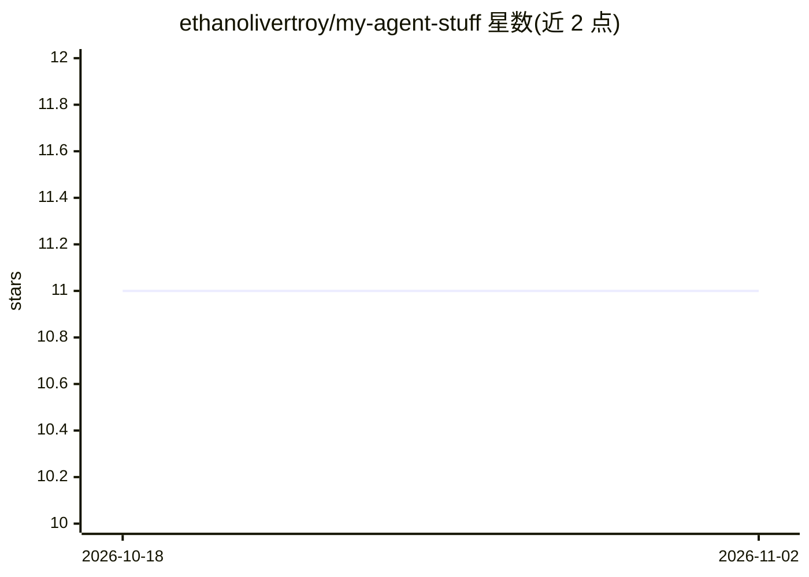

# ethanolivertroy/my-agent-stuff

⭐ 11 · TypeScript · MIT · 推送 2026-07-10 · [GitHub](https://github.com/ethanolivertroy/my-agent-stuff) · 个人维护

**个人维护的 Pi agent 扩展与技能集合（12 扩展/17 技能）**

作者为 Pi agent（pi.dev）定制的 extensions/skills/commands 仓库，目录结构沿用 mitsuhiko/agent-stuff 的组织方式，由 pi manifest 加载。扩展包括 Exa 网页搜索、Linear MCP 镜像、Ollama 本地搜索工具、Grok CLI 接入、Gemini 图像生成、语音合成、子代理编排等；技能覆盖会话导出、EXIF 剥离、IaC 安全扫描、Obsidian 笔记等。仓库自带 Gitleaks 密钥扫描 Git 钩子。属个人配置型仓库，非发布的产品。

## 筛选速览

| 维度 | 判定 | 备注 |
|---|---|---|
| AI 角色 | `ai-ecosystem` | LLM/agent 周边工具 |
| 许可风险 | `permissive` | MIT |
| 部署形态 | `self-host` | docker 或自建部署 |
| 模型依赖 | local-ok | 支持本地模型 |
| 硬件要求 | — | 无带数字的原话,不猜 |
| 安装摩擦 | `low` | 无编译、无系统依赖或容器化 |
| 成熟度 | — | 结构信号不足 |

## 能力要点

- 12 个 Pi 扩展：网页搜索、Linear MCP 镜像、Ollama 本地搜索、Gemini 图像生成、TTS 等
- 17 个技能：会话导出、EXIF 剥离、IaC/服务网格安全扫描、Obsidian 笔记
- Gitleaks 密钥扫描：提交前与推送前自动扫描，支持 SKIP_SECRET_SCAN 绕过
- 统一密钥解析器 src/secret-resolver.ts 管理扩展所需 API token

## 适用场景

- 为 Pi agent 增加搜索、图像生成、语音等工具
- 参考别人如何组织 agent 扩展与技能目录
- 直接复用其中的安全扫描或会话笔记技能

## 场景标签

 · 领域:LLM 工具/agent 扩展

## 证据(README 行号)

> L9: This follows the same broad shape as Armin's `agent-stuff` repo: first-class `extensions/`, `skills/`, and `commands
> L29: |Extension|Description|

## 星数曲线

2026-10-18 11 → 2026-11-02 11（+0）

---
*卡片 v1 · prompt 1.4 · 生成 2026-11-02 · 置信度 mid · 依据 README sha `2e7351a28759` · [字段定义](../../DATASET.md)*
