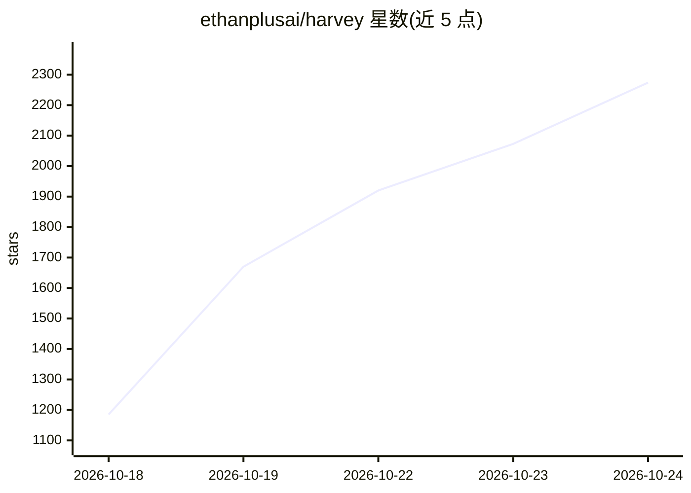

# ethanplusai/harvey

⭐ 2,424 · Python · MIT · 推送 2026-10-24 · [GitHub](https://github.com/ethanplusai/harvey) · 个人维护

**跑在 Claude/Codex 订阅上的自主销售外呼 agent**

本地运行的自动化销售代理：循环心跳调度，经 DISCOVER/PROFILE/ENRICH/VERIFY 四阶段筛选潜在客户，采集 23 种可确认信号，生成个性化冷邮件、发送、读回复并推进约谈。模型调用走用户已有的 Claude Pro/Max（经 Claude Code CLI）或 ChatGPT 订阅（经 Codex），无需 API key、无按 token 计费；自身做配额预算与节流。销售知识以可编辑的 Markdown 技能文件直接拼入 prompt。需 Python 3.11+、订阅、专用邮箱。

## 筛选速览

| 维度 | 判定 | 备注 |
|---|---|---|
| AI 角色 | `ai-native` | 本体是模型或模型工具 |
| 许可风险 | `permissive` | MIT |
| 部署形态 | `library` | 以包/库形式分发 |
| 模型依赖 | locked-api |  |
| 硬件要求 | — | 无带数字的原话,不猜 |
| 安装摩擦 | `low` | 无编译、无系统依赖或容器化 |
| 成熟度 | — | 结构信号不足 |

## 能力要点

- 模型调用走 Claude Code/Codex 订阅，无 API key 与 token 账单
- 23 种信号目录需用户逐项确认，含成本与覆盖数展示
- 四阶段管线（发现/画像/补全/验证），地址按 verified/risky/guess/invalid 标注
- 技能库为纯 Markdown，改文件即改变下一心跳行为，无微调与向量库

## 适用场景

- 我在不付模型 API 费的前提下自动化冷邮件拓客
- 我要按自定义信号构建潜在客户队列并逐条审批外发
- 我想先跑通管线再决定是否让它真正发信（可导出 CSV）

## 场景标签

`AI 写作` `网页抓取` · 领域:效率与自动化

## 证据(README 行号)

> L5: Harvey finds businesses worth selling to, learns something specific about each one, writes cold email that reference
> L7: The unusual part: **there is no model API bill.** Harvey uses your Claude Pro or Max subscription through Claude Cod

## 星数曲线

2026-10-18 1,185 → 2026-10-24 2,274（+1,089）

---
*卡片 v1 · prompt 1.4 · 生成 2026-10-21 · 置信度 mid · 依据 README sha `2956622577e1` · [字段定义](../../DATASET.md)*
