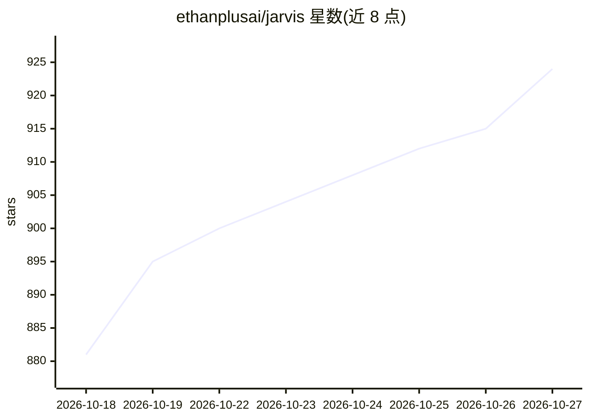

# ethanplusai/jarvis

⭐ 924 · Python · NOASSERTION · 推送 2026-09-10 · [GitHub](https://github.com/ethanplusai/jarvis) · [官网](https://github.com/ethanplusai/jarvis/releases/tag/v2.0.0) · 个人维护

**macOS 语音助手：语音驱动 Claude Code 完成项目设计与构建**

面向已订阅 Claude Code 的开发者，在 Claude 订阅之上运行的语音助手：口头逐步讨论设计并写成设计文档，随后启动真实 Claude Code 会话按计划→评审→执行驱动构建；同时监控机器上所有 Claude Code 会话，遇到等待人工的会话用语音播报。不使用 Anthropic API key，主动剥离环境中的 ANTHROPIC_* 变量；语音由 Fish Audio 提供（需 API key，无回退）。限制：仅 macOS + Chrome，需 Python 3.11+/Node 18+，通过 MCP 连接外部服务。

## 筛选速览

| 维度 | 判定 | 备注 |
|---|---|---|
| AI 角色 | `ai-native` | 本体是模型或模型工具 |
| 许可风险 | `none` | NOASSERTION |
| 部署形态 | `library` | 以包/库形式分发 |
| 模型依赖 | — | README 未给出锁定关系 |
| 硬件要求 | — | 无带数字的原话,不猜 |
| 安装摩擦 | `low` | 无编译、无系统依赖或容器化 |
| 成熟度 | — | 结构信号不足 |

## 能力要点

- 语音逐步头脑风暴并将设计写入项目文件
- 以 claude -p 会话驱动计划→评审→执行，用复选框追踪进度
- 监控全部 Claude Code 会话并语音播报等待人工的会话
- 强制剥离 ANTHROPIC_* 环境变量，只用 Claude 订阅登录

## 适用场景

- 用语音与 Claude Code 讨论并落地一个项目设计
- 构建过程中腾手做事，让助手播报哪个会话在等我确认
- 在仪表盘查看运行记录、会话状态与订阅用量

## 场景标签

`编码 Agent` `语音 Agent` · 领域:编码与开发

## 证据(README 行号)

> L5: JARVIS is a British butler who sits on top of the Claude Code you already pay
> L48: **No AI API usage, and none is possible.** JARVIS's brain is a Claude Code
> L92: - **Drives the build.** A build is a real `claude -p` session handed a brief

## 星数曲线

2026-10-18 881 → 2026-10-27 924（+43）

---
*卡片 v1 · prompt 1.4 · 生成 2026-10-21 · 置信度 mid · 依据 README sha `21c2d6efc477` · [字段定义](../../DATASET.md)*
