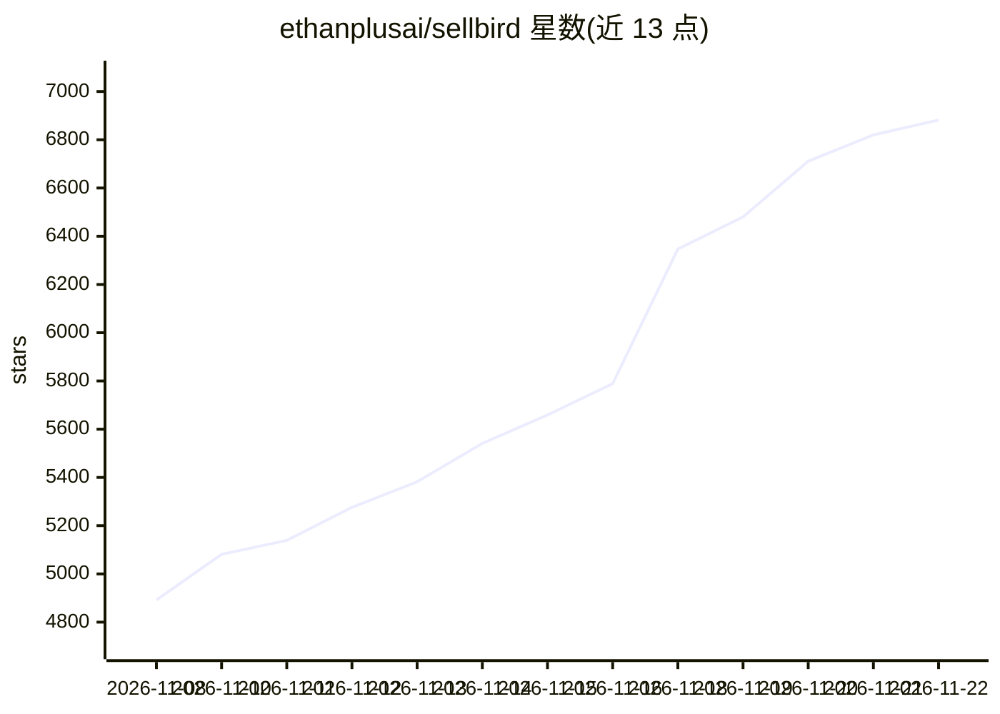

# ethanplusai/sellbird

⭐ 6,882 · Python · AGPL-3.0 · 推送 2026-11-18 · [GitHub](https://github.com/ethanplusai/sellbird) · [官网](https://sellbird.ai) · 个人维护

**用 Claude/ChatGPT 订阅运行的冷邮件外联平台**

开源外联（outreach）流水线：在 OpenStreetMap 或付费数据源检索匹配企业，读取企业网站提取购买信号（无需模型调用），查找决策人、学习并验证邮箱格式，为每人撰写个性化冷邮件序列，经 Gmail/Microsoft 365/SMTP 发送并处理回复。模型推理通过用户已有的 Claude Pro/Max（Claude Code CLI）或 ChatGPT 订阅（Codex CLI）完成，无 API key 与按 token 计费。默认所有外发邮件需人工批准，提供 Docker 运行方式，AGPL-3.0 许可（原 Harvey，0.4.0 起更名）。

## 筛选速览

| 维度 | 判定 | 备注 |
|---|---|---|
| AI 角色 | `ai-native` | 本体是模型或模型工具 |
| 许可风险 | `viral` | AGPL-3.0 |
| 部署形态 | `self-host` | docker 或自建部署 |
| 模型依赖 | locked-api |  |
| 硬件要求 | — | 无带数字的原话,不猜 |
| 安装摩擦 | `low` | 无编译、无系统依赖或容器化 |
| 成熟度 | `idea` | |

## 能力要点

- 端到端外联流水线：找企业→读信号→找决策人→验证邮箱→写发邮件→处理回复
- 复用 Claude Pro/Max 或 ChatGPT 订阅做推理，无 API key 与按 token 计费
- 默认所有外发邮件须经 Outbox 批准，含无模型参与的预发送检查
- 信号读取阶段仅三次 HTTP 请求、不调用模型，默认数据源 $0

## 适用场景

- 用已有 Claude/ChatGPT 订阅跑个性化冷邮件外联，不付模型 API 账单
- 小团队自己搭建销售线索挖掘与邮件验证流水线
- 只需线索列表时导出 sequencer-ready CSV 交给现有邮件工具

## 场景标签

`网页抓取` · 领域:效率与自动化

## 证据(README 行号)

> L9: Sellbird finds companies that need what you sell, finds the person who decides, checks their email address, writes e
> L51: Sellbird thinks through the Claude Code CLI on your Claude Pro or Max plan, or through Codex on a ChatGPT plan. The

## 星数曲线

2026-11-08 4,892 → 2026-11-22 6,882（+1,990）

---
*卡片 v1 · prompt 1.4 · 生成 2026-11-17 · 置信度 high · 依据 README sha `1435835842c8` · [字段定义](../../DATASET.md)*
