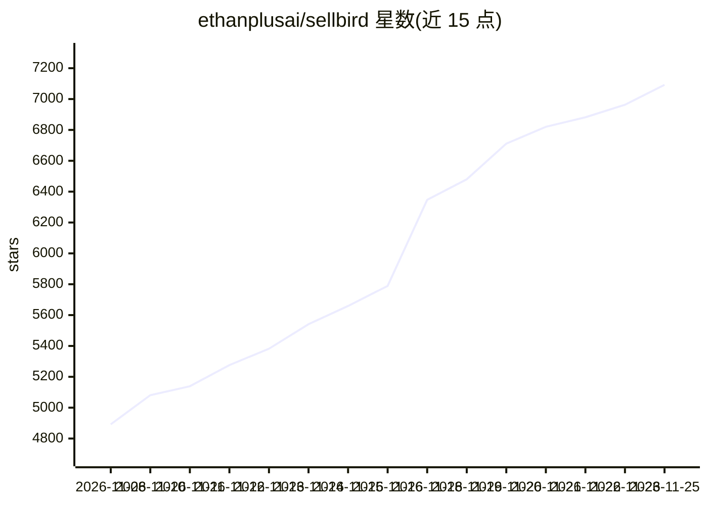

# ethanplusai/sellbird

⭐ 7,092 · Python · AGPL-3.0 · 推送 2026-11-18 · [GitHub](https://github.com/ethanplusai/sellbird) · [官网](https://sellbird.ai) · 组织维护

**跑在 Claude/ChatGPT 订阅上的开源冷邮件外联平台**

Sellbird（原名 Harvey）是一条可端到端运行或分步停止的销售外联流水线：检索匹配的企业、读取其官网提取购买信号、定位决策人、学习邮箱格式并验证地址、生成个性化冷邮件序列并经 Outbox 审批后发送，再读取回复起草答复并即时遵守退订。推理通过用户已有的 Claude Code CLI（Claude Pro/Max 订阅）或 Codex（ChatGPT 订阅）完成，无 API key、无按 token 计费，并自我限速。默认发送需人工批准，含无模型参与的预发送检查。AGPL-3.0 许可，另有 sellbird.ai 托管版（early access）。

## 筛选速览

| 维度 | 判定 | 备注 |
|---|---|---|
| AI 角色 | `ai-native` | 本体是模型或模型工具 |
| 许可风险 | `viral` | AGPL-3.0 |
| 部署形态 | `self-host` | docker 或自建部署 |
| 模型依赖 | locked-api |  |
| 硬件要求 | — | 无带数字的原话,不猜 |
| 安装摩擦 | `low` | 无编译、无系统依赖或容器化 |
| 成熟度 | `idea` | |

## 能力要点

- 五步流水线：找企业→读信号→找决策人→验证邮箱→写发并处理回复
- 通过 Claude Code 或 Codex CLI 运行，使用订阅额度，无模型 API 账单
- 发送前人工审批、预发送规则检查、一键暂停，退订即时生效
- 可导出 sequencer-ready CSV，支持 Docker 与 Linux/macOS/Windows

## 适用场景

- 为自己的产品自动寻找潜在客户并发送个性化冷邮件
- 只需潜在客户名单时在验证一步后停止并导出 CSV
- 在人工审批模式下安全地试验自动化外联

## 场景标签

`工作流自动化` · 领域:效率与自动化

## 证据(README 行号)

> L9: Sellbird finds companies that need what you sell, finds the person who decides, checks their email address, writes e
> L56: Sellbird thinks through the Claude Code CLI on your Claude Pro or Max plan, or through Codex on a ChatGPT plan. The

## 星数曲线

2026-11-08 4,892 → 2026-11-25 7,092（+2,200）

---
*卡片 v1 · prompt 1.4 · 生成 2026-11-22 · 置信度 high · 依据 README sha `6e6de490cbac` · [字段定义](../../DATASET.md)*
