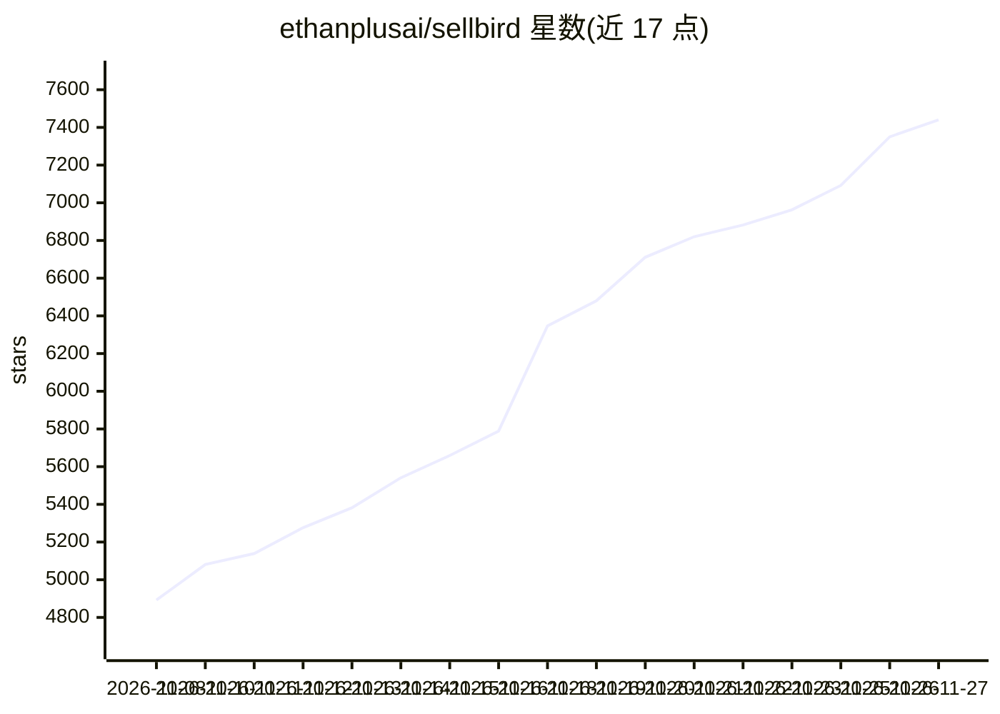

# ethanplusai/sellbird

⭐ 7,440 · Python · AGPL-3.0 · 推送 2026-11-26 · [GitHub](https://github.com/ethanplusai/sellbird) · [官网](https://sellbird.ai) · 个人维护

**跑在 Claude/ChatGPT 订阅上的开源销售外联自动化平台**

在本地运行的外联流水线：搜索匹配目标企业（默认 OpenStreetMap 数据源）、读取企业网站提取购买信号、定位决策人、学习邮箱格式并验证地址、撰写个性化冷邮件并经用户批准后通过 Gmail/Microsoft 365/SMTP 发送、处理回复并尊重退订。默认逐封审批，未批准不发送；LLM 调用走用户已有的 Claude 或 ChatGPT 订阅（Claude Code CLI / Codex CLI），不产生按 token 计费的 API 账单。需 Python 3.11+，许可证 AGPL-3.0，前身为 Harvey。

## 筛选速览

| 维度 | 判定 | 备注 |
|---|---|---|
| AI 角色 | `ai-native` | 本体是模型或模型工具 |
| 许可风险 | `viral` | AGPL-3.0 |
| 部署形态 | `self-host` | docker 或自建部署 |
| 模型依赖 | locked-api |  |
| 硬件要求 | — | 无带数字的原话,不猜 |
| 安装摩擦 | `low` | 无编译、无系统依赖或容器化 |
| 成熟度 | — | 结构信号不足 |

## 能力要点

- 端到端外联流水线：找公司→信号分析→找决策人→验证邮箱→写发邮件→处理回复
- 通过 Claude Code/Codex CLI 使用订阅算力，无 API key 与按 token 计费
- 发件前有非模型预检：未填占位符、禁用短语、超长邮件、多余链接、不可达地址均拦截
- 每个地址标记 verified/risky/guess/invalid，仅向可达地址发送

## 适用场景

- 为我的产品自动找到匹配的中小客户与决策人
- 以人工审批方式控制冷邮件的对外发送
- 用已有 Claude/ChatGPT 订阅跑销售外联而不新增 API 账单
- 只导出经核验的线索 CSV 给既有邮件序列工具

## 场景标签

`工作流自动化` `AI 写作` · 领域:效率与自动化

## 证据(README 行号)

> L9: Sellbird finds companies that need what you sell, finds the person who decides, checks their email address, writes e
> L71: Sellbird thinks through the Claude Code CLI on your Claude Pro or Max plan, or through Codex on a ChatGPT plan. The

## 星数曲线

2026-11-08 4,892 → 2026-11-27 7,440（+2,548）

---
*卡片 v1 · prompt 1.4 · 生成 2026-11-26 · 置信度 high · 依据 README sha `120fa1dc381c` · [字段定义](../../DATASET.md)*
