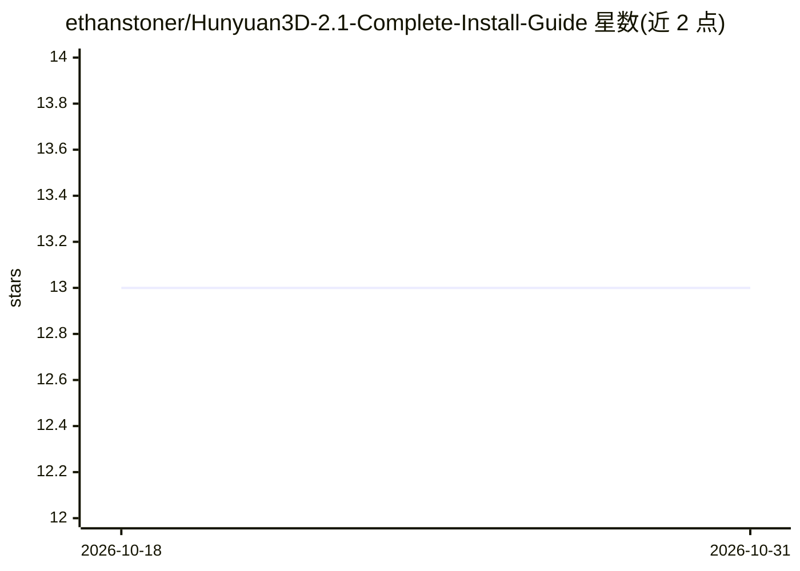

# ethanstoner/Hunyuan3D-2.1-Complete-Install-Guide

⭐ 13 · PowerShell · 推送 2026-09-12 · [GitHub](https://github.com/ethanstoner/Hunyuan3D-2.1-Complete-Install-Guide) · [官网](https://ethanstoner.dev/) · 个人维护

**Windows 上为 ComfyUI 安装 Hunyuan3D-2.1 的脚本化安装指南**

面向在 Windows + NVIDIA 环境使用 ComfyUI Portable 的用户，提供 install.ps1 / Install.bat 一键脚本与手动步骤两种方式，完成 Hunyuan3D-2.1 的自定义节点克隆、依赖安装、wheel 选择、模型下载（约 7.5 GB）与验证。脚本分 7 个幂等阶段，附带 -Doctor 只读诊断与 -DryRun 预览。GPU 需 compute capability 8.0 及以上、8 GB 显存起步，RTX 20 系及更早显卡因预编译 CUDA 光栅化 wheel 不含 Turing 代码而不被支持。另含大量排错条目（onnxruntime、cv2.ximgproc、KJNodes 版本钉住等）。

## 筛选速览

| 维度 | 判定 | 备注 |
|---|---|---|
| AI 角色 | `ai-knowledge` | 知识聚合/清单类 |
| 许可风险 | `none` | — |
| 部署形态 | `desktop` | 安装包/桌面程序 |
| 模型依赖 | — | README 未给出锁定关系 |
| 硬件要求 | `gpu-8g` | |
| 安装摩擦 | `medium` | 含编译或系统依赖之一 |
| 成熟度 | — | 结构信号不足 |

## 能力要点

- install.ps1 一键安装，7 个幂等阶段，支持修复式重跑
- -Doctor 只读诊断与 -DryRun 预览模式
- GPU 要求 compute capability ≥8.0、8 GB 显存，安装前从 nvidia-smi 读取并预警
- 覆盖手动安装步骤与十余条错误排查条目

## 适用场景

- 在 Windows ComfyUI Portable 中部署 Hunyuan3D-2.1 生成 3D 模型
- 已安装但报错时用 -Doctor 定位问题
- 安装前确认自己的 NVIDIA 显卡是否满足要求

## 场景标签

`教程课程` · 领域:学习与行业

## 证据(README 行号)

> L3: **Install Hunyuan3D-2.1 on ComfyUI Portable (Windows, NVIDIA) with one script, or by hand.**
> L14: You need ComfyUI Portable (NVIDIA) v0.3.45 extracted somewhere, plus Git for Windows. That is it.

## 星数曲线

2026-10-18 13 → 2026-10-31 13（+0）

---
*卡片 v1 · prompt 1.4 · 生成 2026-10-31 · 置信度 high · 依据 README sha `4d85a836d529` · [字段定义](../../DATASET.md)*
