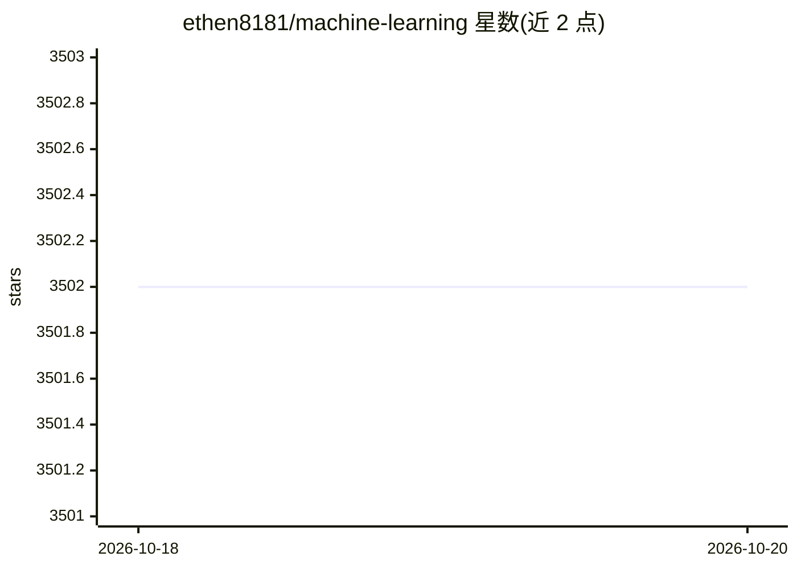

# ethen8181/machine-learning

⭐ 3,502 · HTML · MIT · 推送 2026-10-05 · [GitHub](https://github.com/ethen8181/machine-learning) · 个人维护

**机器学习教程 Jupyter Notebook 合集，含从零实现与开源库用法**

持续更新的个人机器学习/数据科学学习笔记仓库，以 Jupyter Notebook 形式组织，覆盖深度学习、模型部署、推荐系统、树模型、聚类、A/B 测试、时间序列、大数据等约 20 个板块。内容兼顾数学推导、用 numpy/scipy/pandas 等从零实现，以及 scikit-learn、PyTorch、TensorFlow、XGBoost、LightGBM、Hugging Face 等开源库的使用示例，近年条目延伸至 LLM 微调（LoRA/DPO/GRPO）与推理加速。面向学习机器学习与数据科学的开发者和学生。

## 筛选速览

| 维度 | 判定 | 备注 |
|---|---|---|
| AI 角色 | `ai-knowledge` | 知识聚合/清单类 |
| 许可风险 | `permissive` | MIT |
| 部署形态 | `None` |  |
| 模型依赖 | — | README 未给出锁定关系 |
| 硬件要求 | — | 无带数字的原话,不猜 |
| 安装摩擦 | `low` | 无编译、无系统依赖或容器化 |
| 成熟度 | — | 结构信号不足 |

## 能力要点

- 数学推导 + Python 科学栈从零实现 + 开源库用法三层内容
- 覆盖深度学习/推荐系统/树模型/聚类/A/B 测试/大数据等约 20 个板块
- 近年更新含 LLM 微调（LoRA、DPO、GRPO）、推理加速与 FP8 量化条目
- 标注支持的 Python 版本为 3.8–3.10

## 适用场景

- 系统学习经典机器学习算法的原理与实现
- 查找 PyTorch/Hugging Face 等库的上手示例
- 了解 LLM 微调与推理加速主题的入门材料

## 场景标签

`教程课程` · 领域:学习与行业

## 证据(README 行号)

> L10: This is a continuously updated repository that documents personal journey on learning data science, machine learnin
> L12: **Goal:** Introduce machine learning contents in Jupyter Notebook format. The content aims to strike a good balance

## 星数曲线

2026-10-18 3,502 → 2026-10-20 3,502（+0）

---
*卡片 v1 · prompt 1.4 · 生成 2026-10-20 · 置信度 high · 依据 README sha `bca473cf28fb` · [字段定义](../../DATASET.md)*
