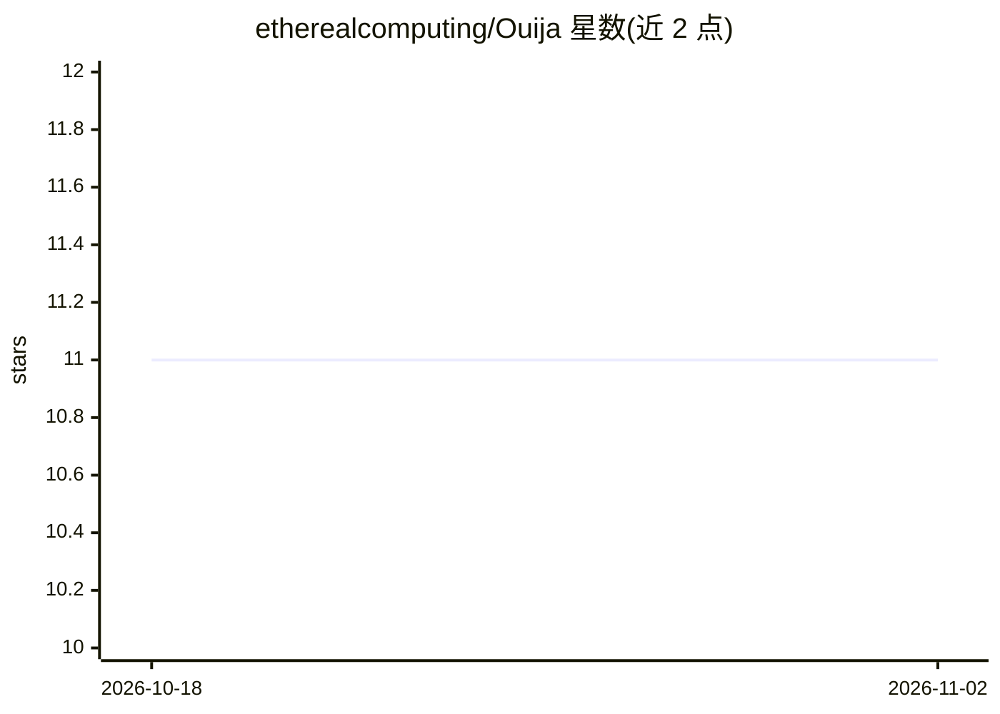

# etherealcomputing/Ouija

⭐ 11 · TypeScript · MIT · 推送 2026-08-17 · [GitHub](https://github.com/etherealcomputing/Ouija) · [官网](https://ouija-ten.vercel.app) · 个人维护

**面向普通人的脑信号可视化与解读系统：多源神经数据转3D大脑与通俗解读**

Ouija 将 EEG、心电、影像（SPECT/MRI/fMRI/fNIRS）、体成分等多模态神经生理数据归一化后，在本地 Next.js 仪表盘中渲染为逐区域填充的实时 3D 大脑（Brain Atlas），并用确定性离线的蒸馏层把指标转为通俗语句（如深睡工作建议）。硬件无关，经 LSL/BrainFlow 实时流与 EDF/CSV 文件接入；用 FastAPI 后端与 MNE 系工具做滤波、特征提取与 ML 状态检测，数据按 BIDS 标准组织。开发阶段设备数据为模拟，无硬件也可运行。

## 筛选速览

| 维度 | 判定 | 备注 |
|---|---|---|
| AI 角色 | `ai-native` | 本体是模型或模型工具 |
| 许可风险 | `permissive` | MIT |
| 部署形态 | `None` |  |
| 模型依赖 | — | README 未给出锁定关系 |
| 硬件要求 | — | 无带数字的原话,不猜 |
| 安装摩擦 | `low` | 无编译、无系统依赖或容器化 |
| 成熟度 | — | 结构信号不足 |

## 能力要点

- LSL/BrainFlow 实时流与 EDF/CSV 文件接入，硬件无关
- 实时 3D Brain Atlas 逐区域填充，达 NOMINAL 状态
- 确定性离线蒸馏层将指标转为通俗语句，可升级 LLM
- 数据转换为标准 BIDS 格式（mne-bids/dcm2niix 等）

## 适用场景

- 把个人 EEG/影像/生理数据整合成一个可视化大脑视图
- 按日/周/月协议自我追踪脑与身体状态
- 无需硬件即可端到端体验模拟数据的仪表盘

## 场景标签

 · 领域:神经科技/健康自量化

## 证据(README 行号)

> L5: **Ouija is God‑View for your brain — for the average person.** It takes the raw, intimidating signals of
> L22: comes online, reaching a **NOMINAL** state when everything is feeding. Over the top sits the distiller: it
> L69:  dimensionality reduction and machine‑learning models to detect states and patterns.

## 星数曲线

2026-10-18 11 → 2026-11-02 11（+0）

---
*卡片 v1 · prompt 1.4 · 生成 2026-11-02 · 置信度 high · 依据 README sha `478f8b5dc668` · [字段定义](../../DATASET.md)*
