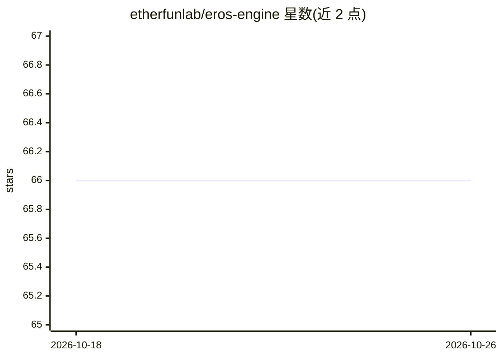

# etherfunlab/eros-engine

⭐ 66 · Rust · AGPL-3.0 · 推送 2026-10-23 · [GitHub](https://github.com/etherfunlab/eros-engine) · [官网](https://eros.etherfun.xyz) · 组织维护 · 中文 README

**Rust 编写的 AI 陪伴角色引擎：持久记忆、关系状态与角色决策**

面向 AI 陪伴类产品的有状态核心引擎，以四个 Rust crate（core/store/llm/server）拆分领域逻辑、模型访问、持久化与 HTTP 服务。提供双层记忆、六维关系模型、生成前的 Persona Decision Engine、结构化用户画像、SSE 流式聊天、可打断的语音回合、可选的模拟世界与群聊（1 用户+3 角色）。默认 OpenRouter 模型路由，可配置 OpenAI 兼容端点；需自备 Postgres 16+ 与 pgvector。官方 Web 客户端闭源，需自带 UI 或嵌入 crate。

## 筛选速览

| 维度 | 判定 | 备注 |
|---|---|---|
| AI 角色 | `ai-ecosystem` | LLM/agent 周边工具 |
| 许可风险 | `dual` | AGPL-3.0 |
| 部署形态 | `self-host` | docker 或自建部署 |
| 模型依赖 | locked-api |  |
| 硬件要求 | — | 无带数字的原话,不猜 |
| 安装摩擦 | `low` | 无编译、无系统依赖或容器化 |
| 成熟度 | — | 结构信号不足 |

## 能力要点

- 双层记忆：稳定事实与共同经历、回调、未完话题并存
- 六维关系模型：分级写入、随时间衰减，影响语气与是否回复
- Persona Decision Engine 在生成前选择行动与内在状态，可选 LLM judge
- SSE 流式聊天与支持 barge-in 的低延迟语音回合通道

## 适用场景

- 构建长期能记住同一用户、关系可演变的陪伴角色产品
- 为日记、教练、导师类应用提供有状态的角色对话核心
- 通过 Docker 部署引擎并以自研 UI 作为前端

## 场景标签

`Agent 框架` `Agent 记忆` · 领域:Agent 开发

## 证据(README 行号)

> L3: **An open-source Rust engine for AI companions that feel real: persistent memory, an evolving relationship model, an
> L30: This is not a generic agent framework. It is the stateful core for products where one persona gets to know the same
> L41: Four crates keep domain logic, model access, persistence, and the HTTP service separate. Run `eros-engine-server` a

## 星数曲线

2026-10-18 66 → 2026-10-26 66（+0）

---
*卡片 v1 · prompt 1.4 · 生成 2026-10-24 · 置信度 high · 依据 README sha `f62fc774a21e` · [字段定义](../../DATASET.md)*
