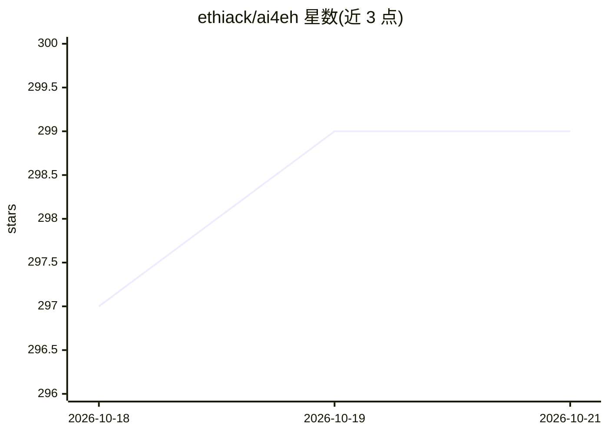

# ethiack/ai4eh

⭐ 299 · Python · MIT · 推送 2025-11-28 · [GitHub](https://github.com/ethiack/ai4eh) · [官网](https://ethiack.com) · 组织维护

**面向学习者的 AI 应用安全（道德黑客）研讨课与实践工具集**

Ethiack 维护的 AI for Ethical Hacking 研讨会仓库，提供教程指南、教学脚本与 Docker 实验环境，内容覆盖 AI 侦察、截图智能分类、内容模糊测试字典生成、nuclei AI 模板生成、CAI hackbot 与 MCP 安全工具集成等。包含 LLM 命令行工具、Nuclei、FFUF/FFUFAI、EyeBaller 等安全工具的容器环境，需配置 OpenAI/Gemini 等 API key。声明仅限教育、授权渗透测试与 CTF 用途。

## 筛选速览

| 维度 | 判定 | 备注 |
|---|---|---|
| AI 角色 | `ai-knowledge` | 知识聚合/清单类 |
| 许可风险 | `permissive` | MIT |
| 部署形态 | `self-host` | docker 或自建部署 |
| 模型依赖 | — | README 未给出锁定关系 |
| 硬件要求 | — | 无带数字的原话,不猜 |
| 安装摩擦 | `low` | 无编译、无系统依赖或容器化 |
| 成熟度 | — | 结构信号不足 |

## 能力要点

- 多模态 LLM 网页应用截图分类脚本
- AI agent 示例（自定义 XSS 工具与通知）
- Docker 预构建镜像 ethiack/ai4eh 一键运行环境
- 内置 Nuclei、FFUF/FFUFAI、EyeBaller 等安全工具

## 适用场景

- 参加研讨会并动手实践 AI 在攻防安全中的应用
- 在 Docker 环境中试用 AI 驱动的侦察与模糊测试工具
- 学习将 AI 助手通过 MCP 接入 Burp Suite 等安全工具

## 场景标签

`网络安全` `教程课程` · 领域:学习与行业

## 证据(README 行号)

> L5: This repository contains the workshop guide, educational tools and scripts for learning how AI can be applied in off
> L9: The AI4EH workshop demonstrates some practical applications of AI in security, including:

## 星数曲线

2026-10-18 297 → 2026-10-21 299（+2）

---
*卡片 v1 · prompt 1.4 · 生成 2026-10-22 · 置信度 high · 依据 README sha `64d2a45e7a1a` · [字段定义](../../DATASET.md)*
