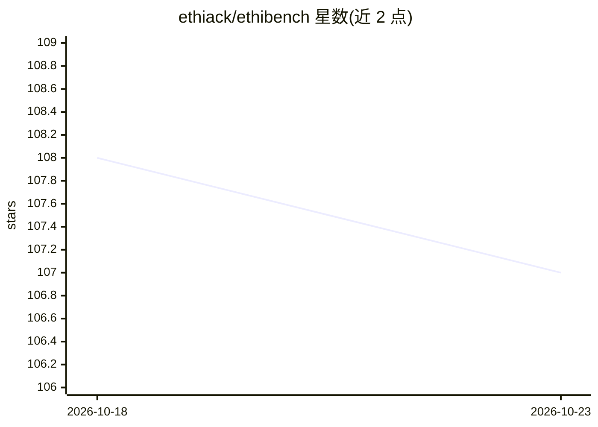

# ethiack/ethibench

⭐ 107 · Python · MIT · 推送 2026-08-20 · [GitHub](https://github.com/ethiack/ethibench) · [官网](https://ethiack.com) · 组织维护

**AI 渗透测试 agent 的评测框架：按漏洞发现打分**

由 Ethiack 维护的可适配评测协议，用于评估 AI 渗透测试 agent 在真实目标上的表现。机制：将 agent 产出的 findings.jsonl 与专家标注的 ground-truth 逐对做 LLM 语义匹配（默认 OpenAI gpt-5.4-mini），再用匈牙利算法做二部图一对一分配，计算 precision/recall/F1/F0.5、CVSS 加权严重度与 CWE 覆盖率，支持多次重复与跨 run 累积分析。自带 108 条标注（vuln-bank/PAYGoat/XBEN-090 三个开源靶标），也支持自带目标与 ground-truth。以 pip 安装的 CLI 提供，需 Python 3.11+ 和 LLM API key。

## 筛选速览

| 维度 | 判定 | 备注 |
|---|---|---|
| AI 角色 | `ai-ecosystem` | LLM/agent 周边工具 |
| 许可风险 | `permissive` | MIT |
| 部署形态 | `library` | 以包/库形式分发 |
| 模型依赖 | local-ok | 支持本地模型 |
| 硬件要求 | — | 无带数字的原话,不猜 |
| 安装摩擦 | `low` | 无编译、无系统依赖或容器化 |
| 成熟度 | — | 结构信号不足 |

## 能力要点

- LLM 语义匹配 + 匈牙利算法二部图分配的漏洞匹配管线
- 计算 precision/recall/F1/F0.5、CVSS 加权严重度分与 CWE 覆盖率
- 自带 108 条专家标注 ground-truth，覆盖 3 个开源靶标
- 支持自带目标/agent/findings，及多次重复与累积分析

## 适用场景

- 评估自己的渗透测试 agent 在真实漏洞靶标上的发现能力
- 将 agent 的 Markdown 报告转为结构化 findings 后打分
- 用自定义 ground-truth 评测内部训练环境上的 agent

## 场景标签

`模型评测` `网络安全` · 领域:评测与运维

## 证据(README 行号)

> L23: AI pentesting agents are increasingly credible as offensive security systems, but current benchmarks still provide 
> L25: This repository contains the code for the proposed **adaptable evaluation protocol** — not a static benchmark. You 
> L139: 2. **Raw LLM matching** — asks an LLM whether each finding–GT pair describes the same vulnerability (YES/NO), prod

## 星数曲线

2026-10-18 108 → 2026-10-23 107（-1）

---
*卡片 v1 · prompt 1.4 · 生成 2026-10-23 · 置信度 high · 依据 README sha `4d1c84a3263d` · [字段定义](../../DATASET.md)*
