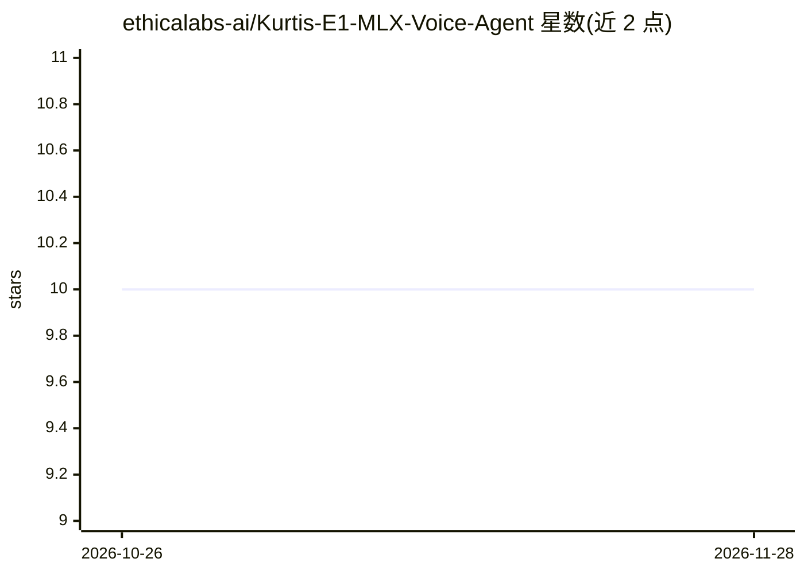

# ethicalabs-ai/Kurtis-E1-MLX-Voice-Agent

⭐ 10 · Python · MIT · 推送 2026-06-10 · [GitHub](https://github.com/ethicalabs-ai/Kurtis-E1-MLX-Voice-Agent) · [官网](https://www.ethicalabs.ai) · 组织维护

**面向 Apple Silicon Mac 用户的完全离线语音情感陪伴助手**

隐私优先的 macOS 本地语音助手，链路由三部分组成：MLX Whisper 做语音转文字、本地 LLM（默认 mlx-lm，可替换为任意 OpenAI 兼容 API 端点）做对话推理、XTTS v2 做多语言语音合成，并可选加载 TowerInstruct-7B 提供离线翻译。定位是共情式心理健康对话，全部推理在本机运行，不上传数据。需 Python >=3.11 与 OpenAI 兼容端点，推荐用 uv 运行，参数可自定义语言、说话人、TTS/Whisper/LLM 模型。

## 筛选速览

| 维度 | 判定 | 备注 |
|---|---|---|
| AI 角色 | `ai-native` | 本体是模型或模型工具 |
| 许可风险 | `permissive` | MIT |
| 部署形态 | `None` |  |
| 模型依赖 | local-ok | 支持本地模型 |
| 硬件要求 | — | 无带数字的原话,不猜 |
| 安装摩擦 | `low` | 无编译、无系统依赖或容器化 |
| 成熟度 | — | 结构信号不足 |

## 能力要点

- STT、LLM、TTS 全链路本地离线运行，面向 Apple Silicon 优化
- LLM 端点可替换为任意 OpenAI 兼容 API（Ollama、LM Studio、vLLM 等）
- 离线翻译组件（TowerInstruct-7B），可用母语与纯英文 LLM 对话
- TTS 在后台 worker 运行以加快启动与播放

## 适用场景

- 在 Mac 上进行不上传数据的本地语音情感陪伴对话
- 需要离线语音助手且重视设备端隐私的场景
- 用母语与纯英文小模型进行语音聊天

## 场景标签

`语音 Agent` · 领域:对话与助手

## 证据(README 行号)

> L3: A privacy-focused, **offline voice assistant for macOS**, powered by:
> L12: It prioritizes simplicity, speed, and on-device privacy for empathetic mental health conversations.

## 星数曲线

2026-10-26 10 → 2026-11-28 10（+0）

---
*卡片 v1 · prompt 1.4 · 生成 2026-11-19 · 置信度 high · 依据 README sha `aa41ee44928e` · [字段定义](../../DATASET.md)*
