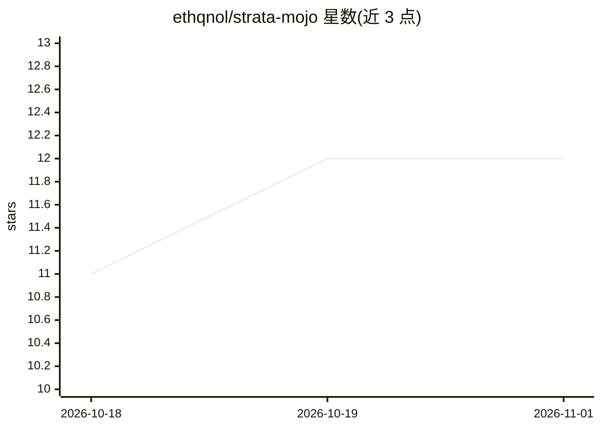

# ethqnol/strata-mojo

⭐ 12 · Mojo · MIT · 推送 2026-10-24 · [GitHub](https://github.com/ethqnol/strata-mojo) · [官网](https://ethqnol.github.io/strata-mojo) · 个人维护

**纯 Mojo 编写的机器学习与线性代数库，接口仿 scikit-learn**

用 Mojo 语言实现的机器学习和线性代数库，面向 Mojo 开发者：提供 scikit-learn 兼容的估计器（线性模型、SVM、决策树、随机森林、梯度提升、朴素贝叶斯、聚类、近邻、降维、预处理、模型选择、评估指标），以及稠密/稀疏矩阵容器、零拷贝二进制序列化与可组合 Pipeline。部分例程（如 LinearRegression、PCA、SVD）依赖 LAPACK/BLAS 加速，需传递链接参数；其余例程为零外部依赖的纯 Mojo 实现。通过 pixi 从 Prefix.dev 的 Modular Community 频道安装。

## 筛选速览

| 维度 | 判定 | 备注 |
|---|---|---|
| AI 角色 | `ai-native` | 本体是模型或模型工具 |
| 许可风险 | `permissive` | MIT |
| 部署形态 | `None` |  |
| 模型依赖 | — | README 未给出锁定关系 |
| 硬件要求 | — | 无带数字的原话,不猜 |
| 安装摩擦 | `low` | 无编译、无系统依赖或容器化 |
| 成熟度 | — | 结构信号不足 |

## 能力要点

- scikit-learn 兼容的估计器与 Pipeline 接口
- 稠密/稀疏矩阵容器与 LAPACK 绑定的线性代数例程
- 零拷贝、端序安全的二进制模型持久化（dump/load）
- NumPy 与 SciPy 稀疏矩阵互转

## 适用场景

- 在 Mojo 项目中做回归、分类、聚类等机器学习任务
- 需要 SIMD/LAPACK 加速的数值计算与矩阵分解
- 用统一 API 组合预处理、训练与评估流水线

## 场景标签

 · 领域:机器学习/数值计算

## 证据(README 行号)

> L7: Strata is a native machine learning and linear algebra library written in Mojo. It provides scikit-learn-compatible 
> L41: Strata combines Mojo's compile-time metaprogramming and hardware SIMD vectorization with zero-copy memory layouts t

## 星数曲线

2026-10-18 11 → 2026-11-01 12（+1）

---
*卡片 v1 · prompt 1.4 · 生成 2026-11-01 · 置信度 high · 依据 README sha `531423b9247e` · [字段定义](../../DATASET.md)*
