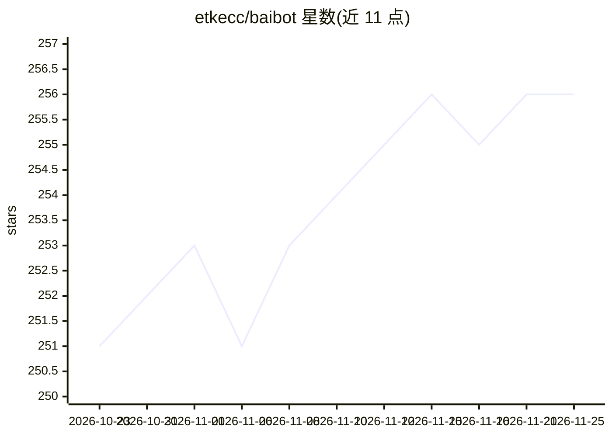

# etkecc/baibot

⭐ 256 · Rust · AGPL-3.0 · 推送 2026-11-23 · [GitHub](https://github.com/etkecc/baibot) · 组织维护

**对接多家 AI 能力的 Matrix 聊天机器人**

由 etke.cc（托管 Matrix 服务器团队）开发的 Matrix AI 机器人，通过接入不同提供商（Anthropic、OpenAI、Groq、LocalAI、Venice 等）调用四类能力：文本生成、语音转文字、文字转语音、图像生成与编辑。支持语音无缝交互（语音消息→文本→回答→语音）、仅转写模式、仅 TTS 模式、Matrix 通信与配置的加密、按提供商的上下文管理（超窗时自动修剪旧消息），以及通过聊天命令在运行时调整配置。安装支持容器运行与二进制两种方式。

## 筛选速览

| 维度 | 判定 | 备注 |
|---|---|---|
| AI 角色 | `ai-ecosystem` | LLM/agent 周边工具 |
| 许可风险 | `viral` | AGPL-3.0 |
| 部署形态 | `None` |  |
| 模型依赖 | locked-api |  |
| 硬件要求 | — | 无带数字的原话,不猜 |
| 安装摩擦 | `low` | 无编译、无系统依赖或容器化 |
| 成熟度 | — | 结构信号不足 |

## 能力要点

- 聚合多家提供商（Anthropic/OpenAI/Groq/LocalAI/Venice 等），支持模型混搭
- 四类用途：text-generation、speech-to-text、text-to-speech、image-generation
- 语音无缝交互与仅转写/仅 TTS 独立模式
- Matrix 通信与账户配置加密，运行时聊天命令改配置

## 适用场景

- 在 Matrix 房间里与多种 LLM 模型对话
- 把 Matrix 语音消息自动转成文字
- 在聊天中生成或编辑图片、把文本转成语音

## 场景标签

`聊天机器人` `图像生成` `语音合成` `语音识别` · 领域:对话与助手

## 证据(README 行号)

> L4: 🤖 baibot is an AI (Large Language Model) bot for Matrix built by etke.cc (managed Matrix servers).
> L13: - 🎨 Encourages **provider choice** (Anthropic, Groq, LocalAI, OpenAI, Venice and ☁️ many more) as well as **mixing 

## 星数曲线

2026-10-23 251 → 2026-11-25 256（+5）

---
*卡片 v1 · prompt 1.4 · 生成 2026-11-25 · 置信度 high · 依据 README sha `b1b5995ba874` · [字段定义](../../DATASET.md)*
