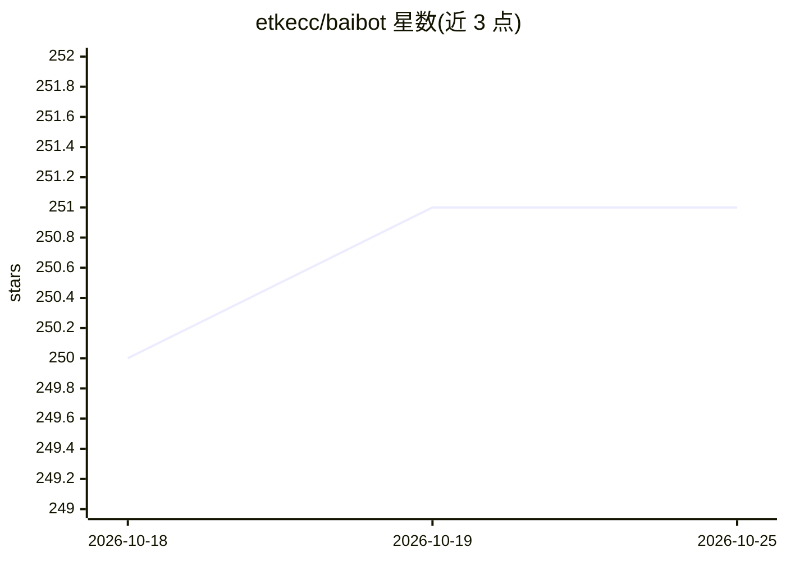

# etkecc/baibot

⭐ 251 · Rust · AGPL-3.0 · 推送 2026-10-25 · [GitHub](https://github.com/etkecc/baibot) · 组织维护

**Matrix 聊天协议上的多用途 AI/LLM 机器人**

由 etke.cc（Matrix 托管服务商）团队维护的 Matrix 机器人，接入多种 AI 提供商（Anthropic、Groq、LocalAI、OpenAI、Venice 等）并支持混搭模型。按用途划分能力：文本生成（OpenAI 通道含网页搜索、代码解释器等内置工具）、语音转文本、文本转语音、图像生成与编辑；支持语音消息到语音回复的无缝交互、仅转录/仅合成模式、Matrix 加密通信、上下文自动裁剪与运行时聊天命令配置。安装方式指向容器或二进制运行的文档，自称是 matrix-chatgpt-bot 的替代。

## 筛选速览

| 维度 | 判定 | 备注 |
|---|---|---|
| AI 角色 | `ai-native` | 本体是模型或模型工具 |
| 许可风险 | `viral` | AGPL-3.0 |
| 部署形态 | `None` |  |
| 模型依赖 | — | README 未给出锁定关系 |
| 硬件要求 | — | 无带数字的原话,不猜 |
| 安装摩擦 | `low` | 无编译、无系统依赖或容器化 |
| 成熟度 | — | 结构信号不足 |

## 能力要点

- 多提供商选择（Anthropic/Groq/LocalAI/OpenAI/Venice 等）与模型混搭
- 文本生成、语音转文本、文本转语音、图像生成四类用途
- 语音消息无缝交互及仅转录/仅合成模式
- Matrix 加密通信与基于 Account Data 的配置存储、运行时命令调整配置

## 适用场景

- 在 Matrix 房间中与多种 LLM 对话并混搭不同模型
- 把语音消息转成文字回答再转回语音
- 用聊天命令在运行时调整机器人配置

## 场景标签

`聊天机器人` `图像生成` · 领域:对话与助手

## 证据(README 行号)

> L4: 🤖 baibot is an AI (Large Language Model) bot for Matrix built by etke.cc (managed Matrix servers).
> L17:  - 💬 text-generation: communicating with you via text (though certain models may "see" images as well). The OpenAI 

## 星数曲线

2026-10-18 250 → 2026-10-25 251（+1）

---
*卡片 v1 · prompt 1.4 · 生成 2026-10-22 · 置信度 high · 依据 README sha `2be0dd3a2e8d` · [字段定义](../../DATASET.md)*
