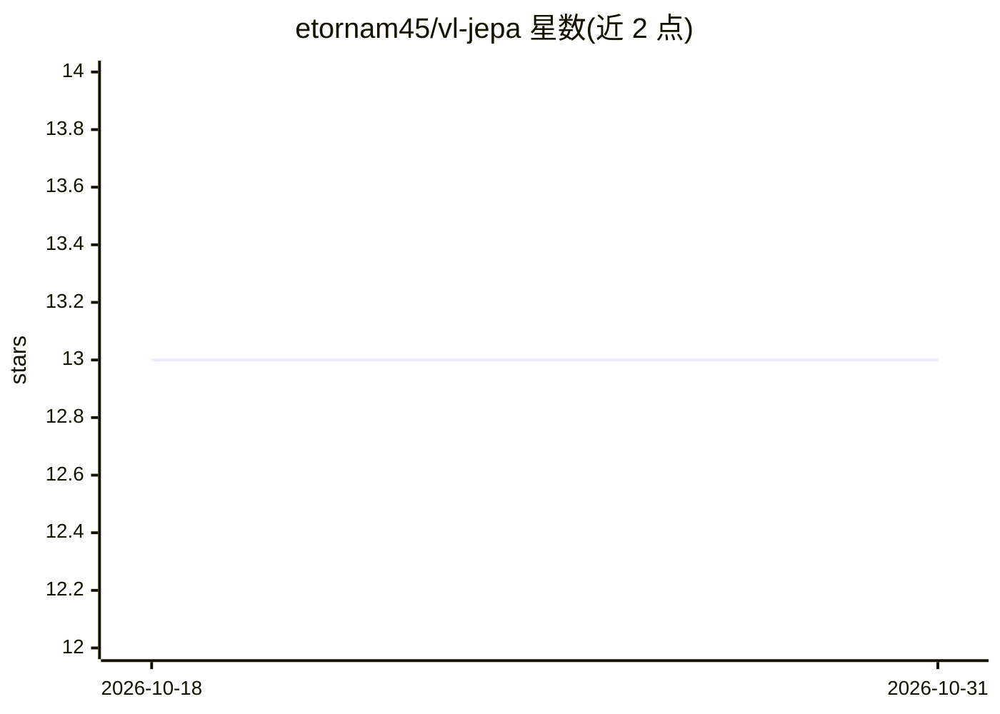

# etornam45/vl-jepa

⭐ 13 · Python · 推送 2026-01-18 · [GitHub](https://github.com/etornam45/vl-jepa) · 个人维护

**VL-JEPA 自监督学习架构的复现实现（DINOv3+EmbeddingGemma）**

受 VL-JEPA 论文启发的视觉-语言自监督训练实现：使用冻结的 DINOv3 ViT-S 作为视频（X）编码器，冻结的 EmbeddingGemma（gemma-3-270m-it）作为 Y 编码器并复用其 embedding 层作 QueryEmbedding，预测器取 gemma 模型最后 4 层，通过投影层映射两个预训练模型间的表示与输出维度，目标是在两个预训练模型之上训练预测器。README 仅给出 MSRVTT 数据集下载目录的说明，未提供安装或运行命令。

## 筛选速览

| 维度 | 判定 | 备注 |
|---|---|---|
| AI 角色 | `ai-native` | 本体是模型或模型工具 |
| 许可风险 | `none` | — |
| 部署形态 | `None` |  |
| 模型依赖 | — | README 未给出锁定关系 |
| 硬件要求 | — | 无带数字的原话,不猜 |
| 安装摩擦 | `low` | 无编译、无系统依赖或容器化 |
| 成熟度 | — | 结构信号不足 |

## 能力要点

- 冻结 DINOv3 ViT-S 作视频编码器
- EmbeddingGemma 作 Y 编码器并复用其 embedding 层
- 投影层映射两个预训练模型间的表示与维度

## 适用场景

- 复现或扩展 VL-JEPA 论文的训练思路
- 研究不同预训练模型间表示对齐的预测器训练
- 视频-语言自监督学习实验

## 场景标签

`模型训练` · 领域:训练与推理

## 证据(README 行号)

> L7:  I used a frozen DINOv3 VIT-S model
> L11: 4. Y-Encoder is the same `EmbeddingGemma` model from the paper. Which I have also frozen
> L13: > The goal is to train a good predictor for the two pretrained models (DINOv3 & EmbeddingGemma)

## 星数曲线

2026-10-18 13 → 2026-10-31 13（+0）

---
*卡片 v1 · prompt 1.4 · 生成 2026-10-31 · 置信度 mid · 依据 README sha `11121ccc3604` · [字段定义](../../DATASET.md)*
