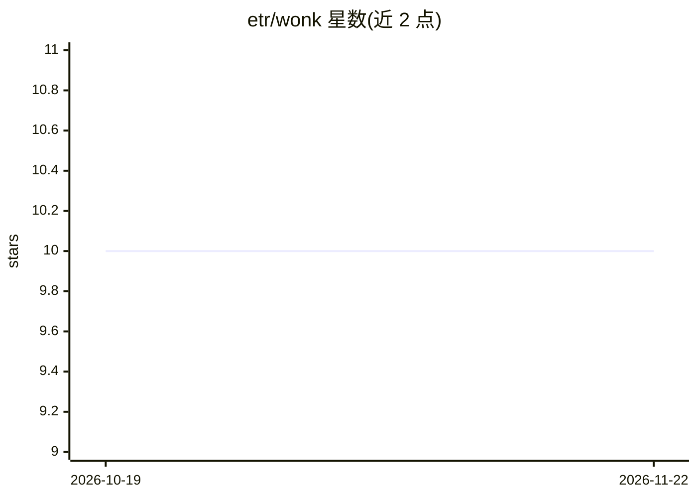

# etr/wonk

⭐ 10 · Rust · MIT · 推送 2026-10-03 · [GitHub](https://github.com/etr/wonk) · 个人维护

**给 AI 编码助手降低 token 消耗的结构感知代码搜索 CLI**

基于 Tree-sitter 预索引代码库的命令行搜索工具：理解定义、调用图、导入与作用域，搜索结果按结构排序去重（定义优先、测试靠后），并提供符号查询、调用图遍历、爆炸半径分析与 diff 审查等 25 个 MCP 工具，供 AI 编码助手通过 stdio JSON-RPC 调用。单静态二进制，零运行时依赖，内置离线嵌入模型，Ollama 为可选高质量档。README 自报基准测试显示 Claude Code token 消耗中位数降低 37.4%。支持 12 种语言，提供 curl/cargo/源码三种安装方式。

## 筛选速览

| 维度 | 判定 | 备注 |
|---|---|---|
| AI 角色 | `ai-ecosystem` | LLM/agent 周边工具 |
| 许可风险 | `permissive` | MIT |
| 部署形态 | `library` | 以包/库形式分发 |
| 模型依赖 | local-ok | 支持本地模型 |
| 硬件要求 | — | 无带数字的原话,不猜 |
| 安装摩擦 | `medium` | 含编译或系统依赖之一 |
| 成熟度 | — | 结构信号不足 |

## 能力要点

- Tree-sitter 索引驱动的结构化排序与去重搜索
- 内置 MCP server 暴露 25 个工具（JSON-RPC 2.0 over stdio）
- 符号查询、调用图、爆炸半径、diff 审查等代码智能命令
- 单静态二进制，捆绑嵌入模型，离线可用

## 适用场景

- 让 Claude Code 等编码代理用结构化搜索替代 grep 以节省上下文
- 在终端快速查符号定义、引用与调用链
- 提交前对 diff 做机械性审查并输出判定
- 多仓库代码库的结构化索引管理

## 场景标签

 · 领域:开发者工具/代码智能

## 证据(README 行号)

> L9: Wonk indexes your codebase with Tree-sitter to understand code structure — definitions, call graphs, imports, and sc
> L131: Wonk's primary audience is AI coding agents. Three integration paths:
> L76: - 25 MCP tools for AI coding assistants (JSON-RPC 2.0 over stdio)

## 星数曲线

2026-10-19 10 → 2026-11-22 10（+0）

---
*卡片 v1 · prompt 1.4 · 生成 2026-11-19 · 置信度 high · 依据 README sha `5160525d2cd3` · [字段定义](../../DATASET.md)*
