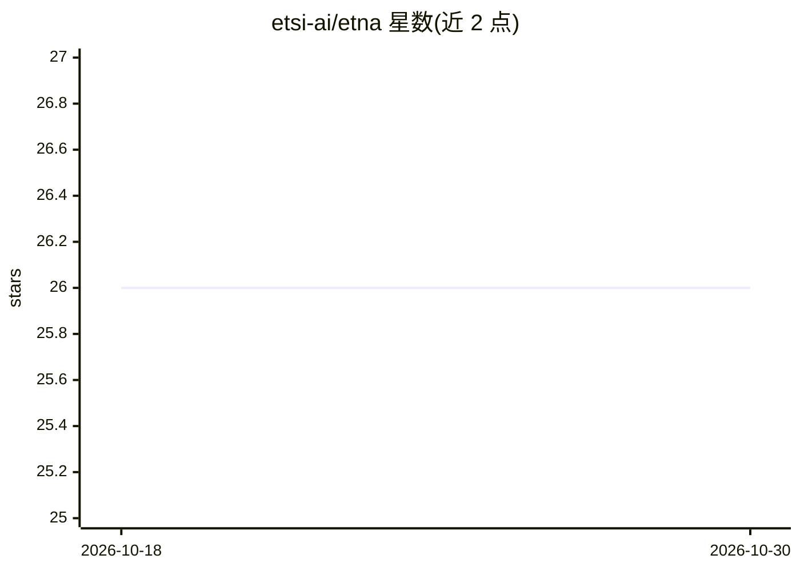

# etsi-ai/etna

⭐ 26 · Python · BSD-2-Clause · 推送 2026-02-25 · [GitHub](https://github.com/etsi-ai/etna) · 组织维护

**面向表格数据的轻量神经网络库，Rust 核心 Python 接口**

etsi-etna 是一个依赖轻量的神经网络库，用于结构化/表格数据的分类与回归任务的训练和评估。核心计算（Linear、ReLU、Softmax、反向传播）由 Rust 实现（etna_core），通过 pyo3 绑定暴露 Scikit-learn 风格的 Python API。提供自动预处理（按列类型缩放与类别编码）、任意深度的多层架构、保存模型时保留权重与优化器状态、可选的单行 MLflow 实验跟踪。面向研究原型、学习与快速部署场景；从源码安装需要 Rust 工具链和 maturin 构建。

## 筛选速览

| 维度 | 判定 | 备注 |
|---|---|---|
| AI 角色 | `ai-native` | 本体是模型或模型工具 |
| 许可风险 | `permissive` | BSD-2-Clause |
| 部署形态 | `library` | 以包/库形式分发 |
| 模型依赖 | — | README 未给出锁定关系 |
| 硬件要求 | — | 无带数字的原话,不猜 |
| 安装摩擦 | `low` | 无编译、无系统依赖或容器化 |
| 成熟度 | — | 结构信号不足 |

## 能力要点

- Rust 核心（Linear/ReLU/Softmax/反向传播）+ pyo3 绑定的 Python API
- 按列类型自动缩放与类别编码
- 支持任意深度多层架构与 Adam 等有状态优化器
- 单行 MLflow 实验跟踪，本地使用时可关闭

## 适用场景

- 在表格数据上快速训练分类或回归模型
- 研究原型与教学学习场景下的轻量建模
- 结合 MLflow 记录训练损失曲线与模型工件

## 场景标签

 · 领域:机器学习/表格数据

## 证据(README 行号)

> L12: `etsi-etna` is a minimalistic, dependency-light neural network library
> L13: designed to make training and evaluating models on structured data fast,
> L24: * **Blazing Fast**: The heavy lifting (Linear layers, ReLU, Softmax, Backprop) is handled by a highly optimized **R

## 星数曲线

2026-10-18 26 → 2026-10-30 26（+0）

---
*卡片 v1 · prompt 1.4 · 生成 2026-10-26 · 置信度 mid · 依据 README sha `3cb6b8b3e34a` · [字段定义](../../DATASET.md)*
