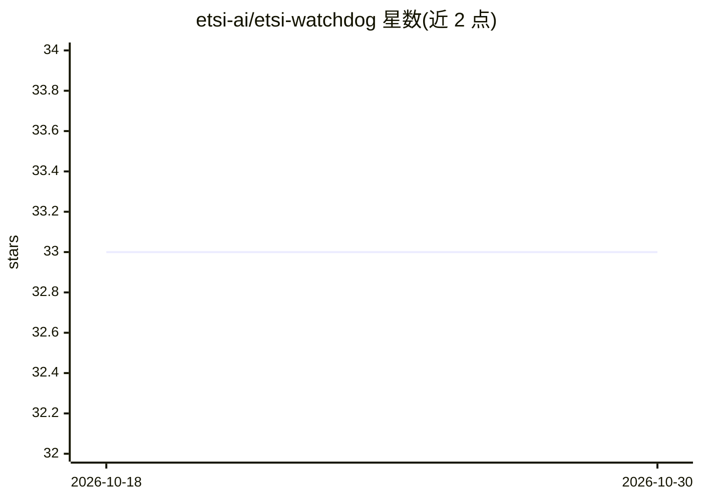

# etsi-ai/etsi-watchdog

⭐ 33 · Python · BSD-2-Clause · 推送 2025-12-30 · [GitHub](https://github.com/etsi-ai/etsi-watchdog) · 组织维护

**ML 管线数据漂移检测与监控库（Python）**

基于 Pandas/NumPy/Scikit-learn 的漂移检测库，面向机器学习管线的生产环境监控：支持静态（训练 vs 推理数据）与滚动时间窗两种监测模式，内置 PSI、KS 检验、Wasserstein 距离及 Isolation Forest 异常检测，检测结果可导出 JSON 或可视化报告，检测到漂移可通过 Slack 按严重级别告警。v3 提供插件式架构，可在运行时注册自定义漂移算法。通过 PyPI 安装，需 Python 3.8+，BSD-2-Clause 许可。

## 筛选速览

| 维度 | 判定 | 备注 |
|---|---|---|
| AI 角色 | `ai-ecosystem` | LLM/agent 周边工具 |
| 许可风险 | `permissive` | BSD-2-Clause |
| 部署形态 | `library` | 以包/库形式分发 |
| 模型依赖 | — | README 未给出锁定关系 |
| 硬件要求 | — | 无带数字的原话,不猜 |
| 安装摩擦 | `low` | 无编译、无系统依赖或容器化 |
| 成熟度 | — | 结构信号不足 |

## 能力要点

- 静态与滚动窗口两种漂移监测模式
- 内置 PSI/KS 检验/Wasserstein 距离与 Isolation Forest
- Slack 告警（含严重级别）与 JSON/可视化报告导出
- v3 动态注册表支持运行时接入自定义漂移算法

## 适用场景

- 上线模型的生产数据与训练数据分布偏移监控
- 定时批任务中按时间窗监测数据流漂移
- 漂移发生时通过 Slack 接收分级告警

## 场景标签

`MLOps` · 领域:训练与推理

## 证据(README 行号)

> L11: `etsi-watchdog` is a modular, production-grade library designed to detect data drift in machine learning pipelines.
> L21: * **Versatile Monitoring**: Supports both **Static** (train vs. inference) and **Rolling** (time-series) monitoring

## 星数曲线

2026-10-18 33 → 2026-10-30 33（+0）

---
*卡片 v1 · prompt 1.4 · 生成 2026-10-25 · 置信度 high · 依据 README sha `34c4c28a54fb` · [字段定义](../../DATASET.md)*
