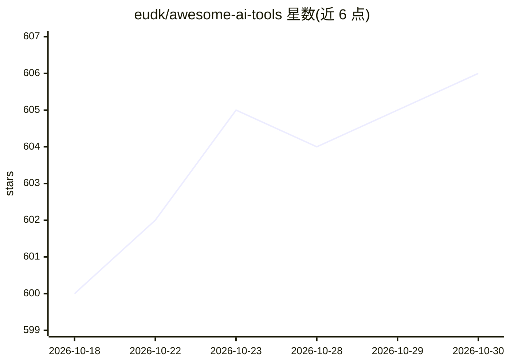

# eudk/awesome-ai-tools

⭐ 606 · CC0-1.0 · 推送 2026-06-07 · [GitHub](https://github.com/eudk/awesome-ai-tools) · 组织维护

**AI 工具策展清单：收录模型、平台与工具的社区导航目录**

自 2023 年维护的社区驱动 AI 工具聚合清单，收录 LLM、多模态生成、AI agent、开发者平台与基础设施工具等类目。导航表覆盖主要 AI 平台（OpenAI、Google、Anthropic、xAI）、中国大模型、AI Graveyard、GPU 租赁、学习资源等 30 余个分类。README 明确声明独立、不背书任何收录工具，提示链接与定价可能过期，需自行核实；目前处于质量审查与清理阶段。无安装步骤，以浏览与贡献指南为主。

## 筛选速览

| 维度 | 判定 | 备注 |
|---|---|---|
| AI 角色 | `ai-knowledge` | 知识聚合/清单类 |
| 许可风险 | `viral` | CC0-1.0 |
| 部署形态 | `library` | 以包/库形式分发 |
| 模型依赖 | — | README 未给出锁定关系 |
| 硬件要求 | — | 无带数字的原话,不猜 |
| 安装摩擦 | `low` | 无编译、无系统依赖或容器化 |
| 成熟度 | — | 结构信号不足 |

## 能力要点

- 30+ 分类覆盖平台、agent、多模态生成、LLM Ops、学习资源
- 收录中国大模型与 AI Graveyard（已停用工具）等专门类目
- 自 2023 年持续维护，社区贡献驱动

## 适用场景

- 查找特定类别的 AI 工具或平台
- 了解 AI 生态各厂商模型与定价概况
- 作为学习 AI/ML 的资源入口

## 场景标签

`精选清单` · 领域:学习与行业

## 证据(README 行号)

> L25: Welcome to a curated collection of tools, models, and platforms across the rapidly evolving landscape of artificial
> L27: This repository focuses on the most relevant systems across:
> L66: |🧠 Major AI Platforms & Model Ecosystems|Overview of leading AI platforms and model ecosystems including OpenAI, Go

## 星数曲线

2026-10-18 600 → 2026-10-30 606（+6）

---
*卡片 v1 · prompt 1.4 · 生成 2026-10-21 · 置信度 mid · 依据 README sha `359a0f80e565` · [字段定义](../../DATASET.md)*
