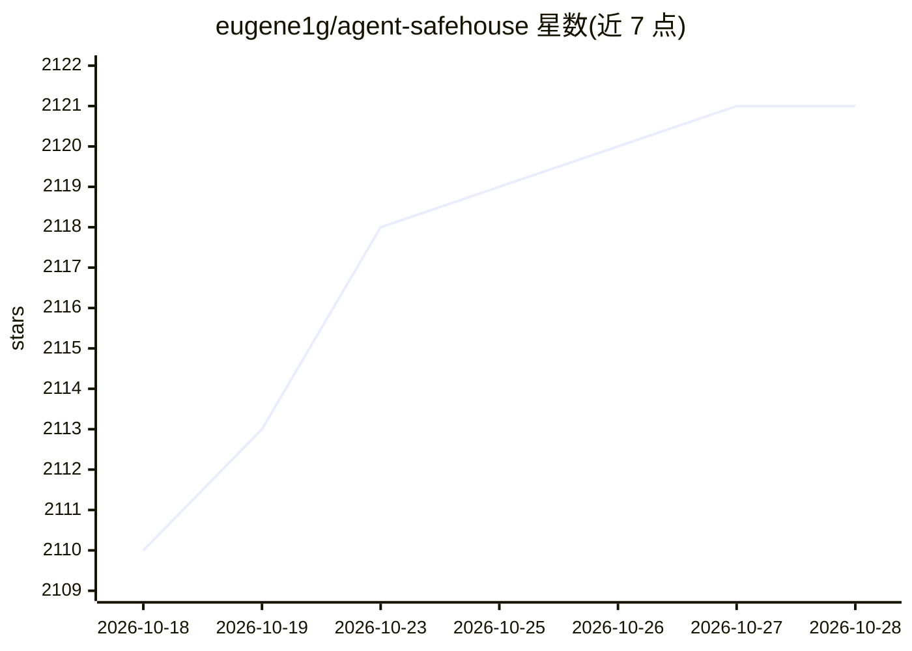

# eugene1g/agent-safehouse

⭐ 2,121 · Shell · Apache-2.0 · 推送 2026-10-21 · [GitHub](https://github.com/eugene1g/agent-safehouse) · [官网](https://agent-safehouse.dev) · 个人维护

**macOS 上为 LLM 编程 agent 做文件/集成权限沙箱的加固层**

基于 macOS sandbox-exec 的命令行沙箱工具：以 deny-first 模型和可组合的策略配置（profiles）限制本地 LLM 编程 agent（如 claude、codex、amp）可读写的文件与集成范围。内置主要编程 agent 的 profiles，支持 HOME/WORK 目录的精细规则渲染、符号链接路径解析、git worktree 自动检测、--append-profile 局部覆盖与 --add-dirs 共享目录授权。仅支持 macOS，README 声明其为加固层而非完备安全边界，并列出多个 Linux 替代方案。通过 Homebrew 或独立脚本安装。

## 筛选速览

| 维度 | 判定 | 备注 |
|---|---|---|
| AI 角色 | `ai-ecosystem` | LLM/agent 周边工具 |
| 许可风险 | `permissive` | Apache-2.0 |
| 部署形态 | `None` |  |
| 模型依赖 | — | README 未给出锁定关系 |
| 硬件要求 | — | 无带数字的原话,不猜 |
| 安装摩擦 | `low` | 无编译、无系统依赖或容器化 |
| 成熟度 | — | 结构信号不足 |

## 能力要点

- 基于 sandbox-exec 的 deny-first 可组合策略 profiles
- 内置主要编程 agent（claude/codex/amp 等）的 profiles
- 符号链接路径解析与 git worktree 自动检测
- 提供 Policy Builder 在线工具与 VitePress 文档站

## 适用场景

- 限制本地 AI 编程 agent 只访问项目所需文件
- 通过附加策略收窄默认 HOME 访问例外
- 团队共享仓库时按机器定制沙箱例外

## 场景标签

`网络安全` · 领域:学习与行业

## 证据(README 行号)

> L7: Sandbox your LLM coding agents on macOS so they can only access the files and integrations they actually need.
> L9: Agent Safehouse uses `sandbox-exec` with composable policy profiles and a deny-first model. It includes profiles for
> L37: It is a hardening layer, not a perfect security boundary against a determined attacker.

## 星数曲线

2026-10-18 2,110 → 2026-10-28 2,121（+11）

---
*卡片 v1 · prompt 1.4 · 生成 2026-10-21 · 置信度 high · 依据 README sha `d71fb69594ae` · [字段定义](../../DATASET.md)*
