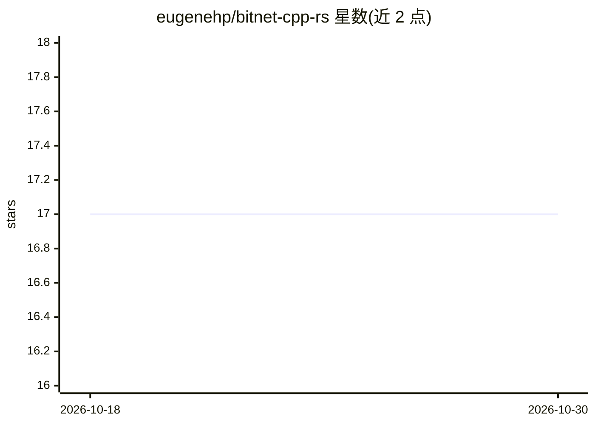

# eugenehp/bitnet-cpp-rs

⭐ 17 · Rust · MIT · 推送 2025-12-28 · [GitHub](https://github.com/eugenehp/bitnet-cpp-rs) · 个人维护

**Rust 语言的 BitNet.cpp 绑定库，供开发者调用其推理能力**

基于 llama-cpp-4 的 BitNet-cpp Rust 绑定，封装方式为 'almost safe wrapper'，使 Rust 项目能够调用 BitNet.cpp 的 1-bit 模型推理。本体是绑定库而非完整应用，开发细节指向 bitnet-cpp-sys。平台支持有限：macOS Apple Silicon（arm64）完整测试，x64 均不支持，Linux/Windows 仅 ARM 待测试；设计受 llama-cpp-rs 启发，MIT 许可，2024-2026 年由个人维护。

## 筛选速览

| 维度 | 判定 | 备注 |
|---|---|---|
| AI 角色 | `ai-ecosystem` | LLM/agent 周边工具 |
| 许可风险 | `permissive` | MIT |
| 部署形态 | `None` |  |
| 模型依赖 | — | README 未给出锁定关系 |
| 硬件要求 | — | 无带数字的原话,不猜 |
| 安装摩擦 | `low` | 无编译、无系统依赖或容器化 |
| 成熟度 | `idea` | |

## 能力要点

- 基于 llama-cpp-4 封装的 BitNet-cpp Rust 绑定
- macOS Apple Silicon 完整测试（x64 不支持）
- Linux/Windows ARM 状态为待测试

## 适用场景

- 在 Rust 项目中调用 BitNet.cpp 运行 1-bit LLM 推理
- 在 Apple Silicon 上的 Rust 应用集成 BitNet 模型

## 场景标签

`推理引擎` · 领域:训练与推理

## 证据(README 行号)

> L1: # BitNet.cpp for Rust
> L3: Almost safe wrapper for BitNet-cpp based on llama-cpp

## 星数曲线

2026-10-18 17 → 2026-10-30 17（+0）

---
*卡片 v1 · prompt 1.4 · 生成 2026-10-29 · 置信度 high · 依据 README sha `2e6a689e0e6a` · [字段定义](../../DATASET.md)*
