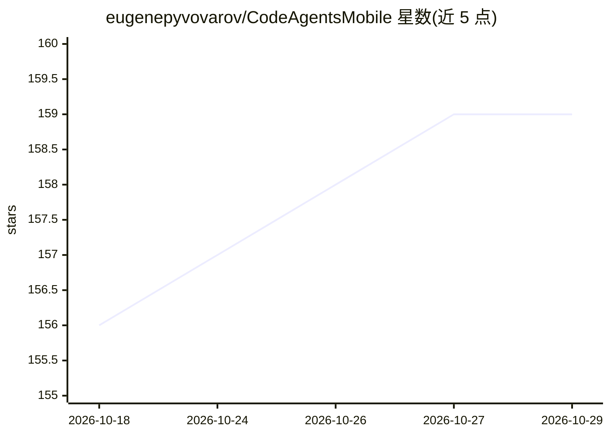

# eugenepyvovarov/CodeAgentsMobile

⭐ 159 · Swift · Apache-2.0 · 推送 2026-07-21 · [GitHub](https://github.com/eugenepyvovarov/CodeAgentsMobile) · [官网](https://x.com/code_agents) · 个人维护

**iOS 客户端：通过 SSH 连接服务器使用 OpenCode 编码 agent**

OpenCode 的 iOS 移动客户端：用户连接任意 Linux SSH 服务器，在手机上与编码 agent 对话，支持后台任务、技能管理、文件浏览编辑、MCP 服务器、规则与权限等 agent 控制。提供商可选 Anthropic、Z.ai、Minimax、Moonshot，可从 Digital Ocean/Hetzner 一键开通服务器。旧版 Claude Code/Claude Proxy 聊天已退役并自动迁移至 OpenCode。需 iOS 17.0+，提供 TestFlight 与 App Store 渠道，构建需 Xcode 15+。

## 筛选速览

| 维度 | 判定 | 备注 |
|---|---|---|
| AI 角色 | `ai-ecosystem` | LLM/agent 周边工具 |
| 许可风险 | `permissive` | Apache-2.0 |
| 部署形态 | `None` |  |
| 模型依赖 | — | README 未给出锁定关系 |
| 硬件要求 | — | 无带数字的原话,不猜 |
| 安装摩擦 | `medium` | 含编译或系统依赖之一 |
| 成熟度 | — | 结构信号不足 |

## 能力要点

- SSH 连接远程服务器并驱动 OpenCode 编码 agent
- 后台任务、技能管理与 MCP 服务器支持
- 文件浏览、编辑、上传与分享工具
- 可从 Digital Ocean/Hetzner 一键开通并配置服务器

## 适用场景

- 在手机上继续使用部署在远程服务器的编码 agent
- 通勤或外出时查看 agent 进度并执行后台任务
- 不开本地电脑直接通过 SSH 管理编码项目

## 场景标签

`编码 Agent` · 领域:编码与开发

## 证据(README 行号)

> L3: An mobile client for **OpenCode** on iOS.
> L30: - More provider choices: Anthropic, Z.ai, Minimax, or Moonshot

## 星数曲线

2026-10-18 156 → 2026-10-29 159（+3）

---
*卡片 v1 · prompt 1.4 · 生成 2026-10-22 · 置信度 high · 依据 README sha `b716434e94c5` · [字段定义](../../DATASET.md)*
