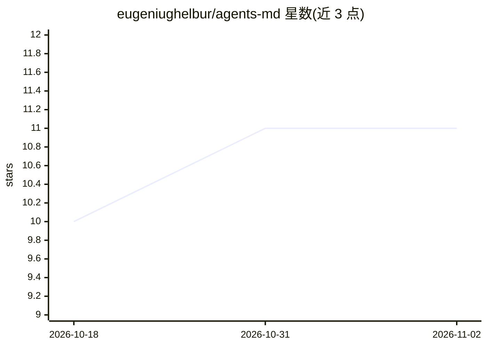

# eugeniughelbur/agents-md

⭐ 11 · JavaScript · MIT · 推送 2026-06-24 · [GitHub](https://github.com/eugeniughelbur/agents-md) · [官网](https://eugeniughelbur.github.io/agents-md/) · 个人维护

**为仓库生成并安全维护跨工具 AGENTS.md 的 CLI 工具**

面向开发者的命令行工具，扫描仓库（manifests、脚本、Makefile、git 历史、CI、.env.example）生成约 200 行的 AGENTS.md——供 Cursor、Copilot、Codex、Claude Code 等 AI 编码代理读取的跨工具标准文件，并将 CLAUDE.md 符号链接到同一文件。生成区块用 HTML 注释标记包裹，重跑只刷新自身区块；无法检测的内容留为待填 stub 而非编造。CLI 零依赖、无需 API key、不发网络请求；另有 LLM 驱动的 Claude Code skill 形式，可生成更深入内容。

## 筛选速览

| 维度 | 判定 | 备注 |
|---|---|---|
| AI 角色 | `ai-ecosystem` | LLM/agent 周边工具 |
| 许可风险 | `permissive` | MIT |
| 部署形态 | `library` | 以包/库形式分发 |
| 模型依赖 | — | README 未给出锁定关系 |
| 硬件要求 | — | 无带数字的原话,不猜 |
| 安装摩擦 | `low` | 无编译、无系统依赖或容器化 |
| 成熟度 | — | 结构信号不足 |

## 能力要点

- 生成跨工具 AGENTS.md 并 symlink CLAUDE.md，多工具共用单文件
- 标记契约实现非破坏性重跑，手写内容不被覆盖
- 事实仅来自仓库读取，未检出内容留 stub 不编造
- 三层边界区（✅/⚠️/🚫）+ CLI 零依赖无网络调用

## 适用场景

- 为使用多个 AI 编码代理的仓库维护单份指令文件
- 初始化项目时快速生成含命令、结构与边界的 AGENTS.md
- 在已有手写 AGENTS.md 上安全刷新生成部分

## 场景标签

 · 领域:开发者工具/AI 代理配置

## 证据(README 行号)

> L1: agents-md: generate and safely maintain an AGENTS.md, the cross-tool standard read by Cursor, GitHub Copilot, Codex,
> L20: One `AGENTS.md` works across Codex, Cursor, GitHub Copilot, Gemini CLI, Aider, Windsurf, Zed, Devin, and more. `CLA
> L61: **As a Claude Code skill (LLM-powered, richer):**

## 星数曲线

2026-10-18 10 → 2026-11-02 11（+1）

---
*卡片 v1 · prompt 1.4 · 生成 2026-11-02 · 置信度 high · 依据 README sha `5ce7fcd13e20` · [字段定义](../../DATASET.md)*
