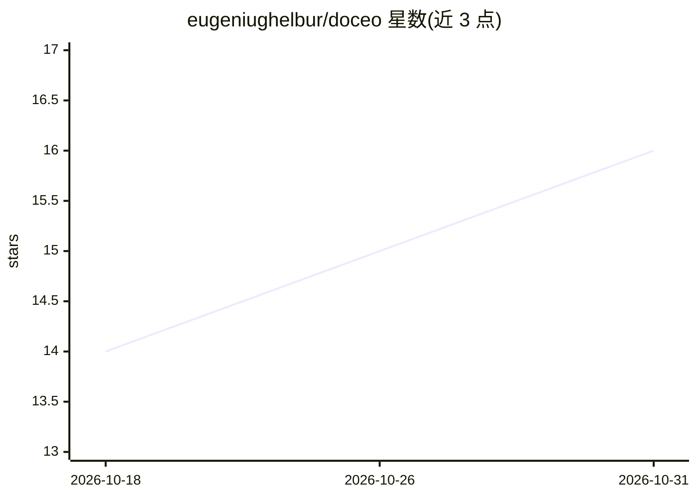

# eugeniughelbur/doceo

⭐ 16 · MIT · 推送 2026-10-25 · [GitHub](https://github.com/eugeniughelbur/doceo) · 个人维护

**Claude Code 个人学习技能：把任意主题变为一屏可视化课程**

面向使用 Claude Code 的开发者的 AI 导师技能（skill）。以 /doceo 命令将概念、仓库、文件、URL 或对话中的困惑点转换为一屏课程：一句回答、SVG 示意图、类比、自测题，并生成 HTML 页面与 Mermaid markdown 笔记。通过本地记忆文件夹（profile/learnings/index/领域地图）记录已学内容，课后反馈提炼为教学规则供后续课程读取。安装方式为 git clone 到 ~/.claude/skills，需 Claude Code 运行，数据全部本地存储。

## 筛选速览

| 维度 | 判定 | 备注 |
|---|---|---|
| AI 角色 | `ai-ecosystem` | LLM/agent 周边工具 |
| 许可风险 | `permissive` | MIT |
| 部署形态 | `None` |  |
| 模型依赖 | — | README 未给出锁定关系 |
| 硬件要求 | — | 无带数字的原话,不猜 |
| 安装摩擦 | `low` | 无编译、无系统依赖或容器化 |
| 成熟度 | — | 结构信号不足 |

## 能力要点

- 固定课程结构：回答+SVG 图+类比+自测题，约一屏
- 本地记忆文件夹（profile/teaching rules/课程索引/领域地图）实现课程递进
- 每课后一道反馈题，沉淀为教学规则的自改进循环
- 生成 HTML 课程页与含 Mermaid 图的 markdown 笔记，可放入 Obsidian

## 适用场景

- 快速理解陌生概念、仓库或继承的代码模块
- 把技术任务拆成带完成标准的婴儿步骤
- 让解释基于我已知的内容逐步积累，而非每次从零开始

## 场景标签

`教程课程` · 领域:学习与行业

## 证据(README 行号)

> L5: An open-source **AI tutor skill for Claude Code**. Point it at anything you don't understand and instead of a wall o
> L226: Claude Code (CLI, desktop, or IDE extension). No API keys, no external services, no dependencies.

## 星数曲线

2026-10-18 14 → 2026-10-31 16（+2）

---
*卡片 v1 · prompt 1.4 · 生成 2026-10-30 · 置信度 high · 依据 README sha `708e3b44b099` · [字段定义](../../DATASET.md)*
