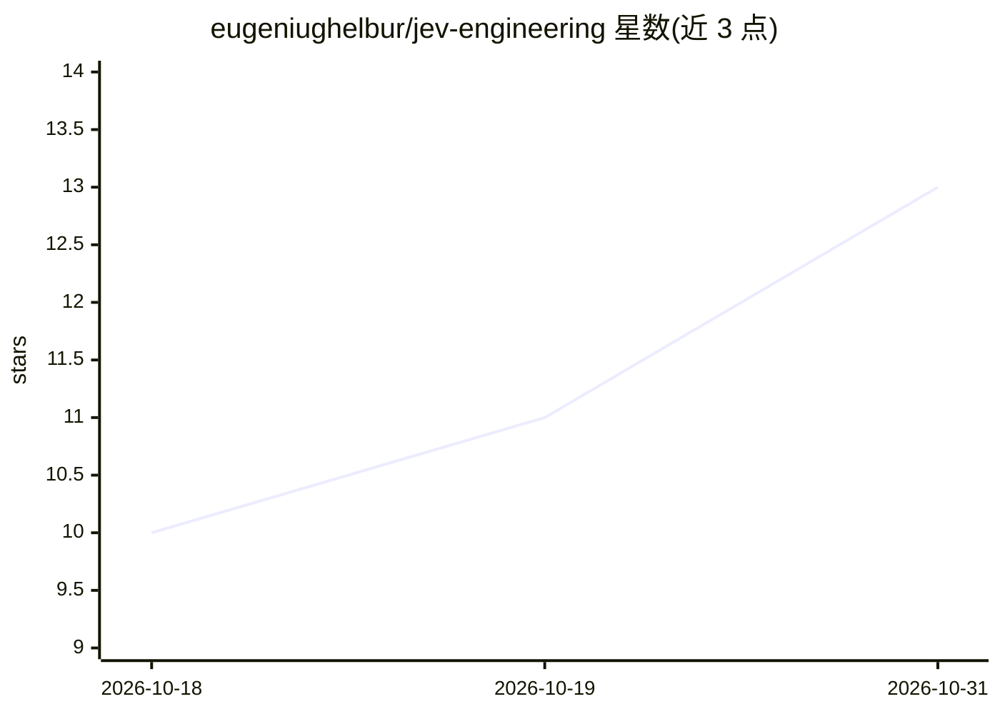

# eugeniughelbur/jev-engineering

⭐ 13 · Python · MIT · 推送 2026-10-25 · [GitHub](https://github.com/eugeniughelbur/jev-engineering) · [官网](https://eugeniughelbur.github.io/jev-engineering/) · 个人维护

**基于 Jev 模型的编码代理守门与审查路由工具集**

构建在 TypeSafe Jev（快速是/否判断模型）之上的三个工具：review-router 是 GitHub Action，读 diff 内容而非文件名路由 AI 代码审查（13 个 CVE 修复全部送往完整审查）；jev-gate 对代理执行的每条命令做二次裁决，按硬规则、只读白名单、Jev 模型询问、阈值四层顺序判定，支持 observe/auto/guard/enforce 四种模式；另有 route/rank/keep 三个模型分层与上下文筛选工具，可作 MCP 工具暴露。通过 Claude Code 插件、pip、源码或后台服务安装，需 OpenRouter API key。仅拦截事故，作者声明不防蓄意攻击者。

## 筛选速览

| 维度 | 判定 | 备注 |
|---|---|---|
| AI 角色 | `ai-ecosystem` | LLM/agent 周边工具 |
| 许可风险 | `permissive` | MIT |
| 部署形态 | `library` | 以包/库形式分发 |
| 模型依赖 | locked-api |  |
| 硬件要求 | — | 无带数字的原话,不猜 |
| 安装摩擦 | `low` | 无编译、无系统依赖或容器化 |
| 成熟度 | — | 结构信号不足 |

## 能力要点

- review-router 按 diff 内容路由完整审查，13/13 CVE 修复命中
- jev-gate 四层判定顺序：硬规则→白名单→Jev 模型→自定阈值
- observe/auto/guard/enforce 四模式，observe 默认只记录不干预
- 五个问题包（shell/message/money/data/publish）覆盖命令外的代理行为

## 适用场景

- 给 Claude Code/Codex/Cursor 的编码代理加命令执行守门
- 让 AI 代码审查按 diff 内容决定是否读整个 PR
- 团队用统一 policy.json 分发硬规则与阈值

## 场景标签

`代码审查` · 领域:编码与开发

## 证据(README 行号)

> L10: |jev-gate|A strict second lock on every command your coding agent runs|Once a session claimed it was authorized, Cl
> L29: ## jev-gate: a strict second lock
> L31: Claude Code and Codex both ship their own auto-approval now: Claude Code's auto mode and Codex's Guardian. Use them

## 星数曲线

2026-10-18 10 → 2026-10-31 13（+3）

---
*卡片 v1 · prompt 1.4 · 生成 2026-10-31 · 置信度 high · 依据 README sha `08f1a1599fd5` · [字段定义](../../DATASET.md)*
