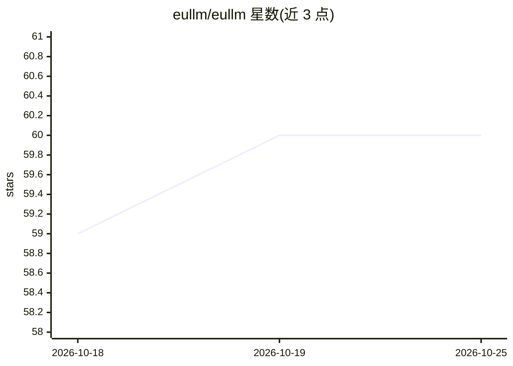

# eullm/eullm

⭐ 60 · Python · AGPL-3.0 · 推送 2026-10-25 · [GitHub](https://github.com/eullm/eullm) · [官网](https://www.eullm.eu) · 组织维护

**本地优先的欧盟合规 LLM 推理引擎：单一 Rust 二进制，兼容 Ollama/OpenAI API**

由意大利 I3K Technologies 开发的本地 LLM 运行时：一个 Rust 二进制加载任意 GGUF 模型，在 11434 端口提供 Ollama 与 OpenAI 兼容 API，Open WebUI、LangChain、n8n 等客户端可不加修改地使用。特色包括 /v1/systemone 决策端点（直接读取各选项概率而非生成文本）、本地审计日志（记录模型/token/耗时而非文本）、连续批处理、多模型并行加载。Forge 组件用于将开源模型蒸馏为领域专用小模型（首个为意大利法律模型 legal-it-8b）。支持 CUDA/ROCm/Vulkan/Metal/CPU，从 ARM 板到 EuroHPC 超算均可运行。AGPL-3.0 外另提供商业许可。

## 筛选速览

| 维度 | 判定 | 备注 |
|---|---|---|
| AI 角色 | `ai-ecosystem` | LLM/agent 周边工具 |
| 许可风险 | `dual` | AGPL-3.0 |
| 部署形态 | `None` |  |
| 模型依赖 | — | README 未给出锁定关系 |
| 硬件要求 | — | 无带数字的原话,不猜 |
| 安装摩擦 | `high` | 编译与系统依赖俱全 |
| 成熟度 | `idea` | |

## 能力要点

- 单一 Rust 二进制，Ollama/OpenAI 兼容 API，Open WebUI/LangChain/n8n 客户端免修改使用
- /v1/systemone 决策端点：读取各选项概率而非生成，64 问 0.66 秒（RTX 5070 Ti）
- 本地审计日志按 EU AI Act 记录保存要求设计，记录模型/token/耗时而不含文本
- Forge：剪枝、蒸馏、领域微调并量化为 GGUF，产出 legal-it-8b 等领域模型

## 适用场景

- 在自有硬件上运行 GGUF 模型并替代 Ollama/OpenAI API 端点
- 用 /v1/systemone 做工单分派、邮件分类、文档审核等毫秒级结构化决策
- 为欧盟受监管行业（法律/医疗/金融）构建满足 AI Act 记录要求的本地 AI 服务

## 场景标签

`推理引擎` `微调` `模型量化` · 领域:训练与推理

## 证据(README 行号)

> L5:  One Rust binary · OpenAI- and Ollama-compatible API · no telemetry, no external API · an audit trail designed for t
> L38: |🔌 **A drop-in for Ollama and OpenAI**|The same API on port 11434: Open WebUI, LangChain, n8n and any OpenAI client
> L85: - **A drop-in replacement.** The Ollama and OpenAI APIs on port 11434:

## 星数曲线

2026-10-18 59 → 2026-10-25 60（+1）

---
*卡片 v1 · prompt 1.4 · 生成 2026-10-24 · 置信度 high · 依据 README sha `9b7659eef7cf` · [字段定义](../../DATASET.md)*
