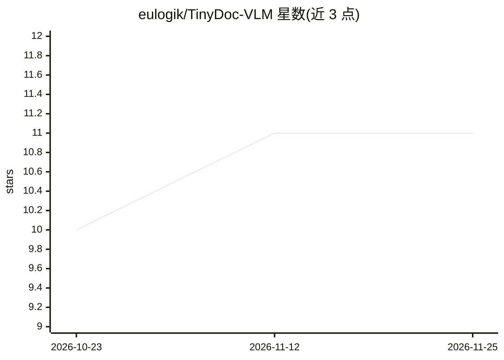

# eulogik/TinyDoc-VLM

⭐ 11 · Python · Apache-2.0 · 推送 2026-11-16 · [GitHub](https://github.com/eulogik/TinyDoc-VLM) · [官网](https://huggingface.co/spaces/eulogik/TinyDoc-VLM) · 个人维护

**本地运行的收据/发票抽取 SDK，输出带证据引文的 JSON**

TinyDoc 是开源 Python SDK 与 CLI，将收据和发票图像转换为 schema 校验的 JSON，每个字段附带精确 OCR 出处片段与置信度，并支持低置信度字段转人工审核。运行时依赖本地 Ollama 加载 Qwen2.5-VL-3B 或 Qwen3-VL-2B-Instruct 读取模型，无 API key、无云端、无遥测。RapidOCR 词框对齐提供页面级出处；多页发票采用分页读取加 OCR 合计校验的流水线。注意首方 256M 检查点已退役，目前无微调模型。

## 筛选速览

| 维度 | 判定 | 备注 |
|---|---|---|
| AI 角色 | `ai-native` | 本体是模型或模型工具 |
| 许可风险 | `permissive` | Apache-2.0 |
| 部署形态 | `library` | 以包/库形式分发 |
| 模型依赖 | local-ok | 支持本地模型 |
| 硬件要求 | — | 无带数字的原话,不猜 |
| 安装摩擦 | `low` | 无编译、无系统依赖或容器化 |
| 成熟度 | — | 结构信号不足 |

## 能力要点

- 每个字段输出 quote/bbox 出处与置信度分数
- 本地 Ollama 运行 Qwen VLM，无需 API key 与云端
- Schema 校验失败拒绝/修复，低置信字段路由人工审核
- 支持多页 PDF 与本地 Gradio UI（仅 127.0.0.1）

## 适用场景

- 把收据/发票图片批量转成结构化 JSON 入账
- 对抽取字段做人工复核流程（低置信度路由）
- 数据不能离开本机的票据抽取场景

## 场景标签

`文档解析` · 领域:知识与检索

## 证据(README 行号)

> L15: **TinyDoc is an open-source Python SDK and CLI that turns receipt and invoice
> L17: score attached to every field.** It runs a local vision-language model through
> L18: Ollama — no API key, no cloud, no telemetry — then adds

## 星数曲线

2026-10-23 10 → 2026-11-25 11（+1）

---
*卡片 v1 · prompt 1.4 · 生成 2026-11-18 · 置信度 high · 依据 README sha `4ea129c0f5fe` · [字段定义](../../DATASET.md)*
