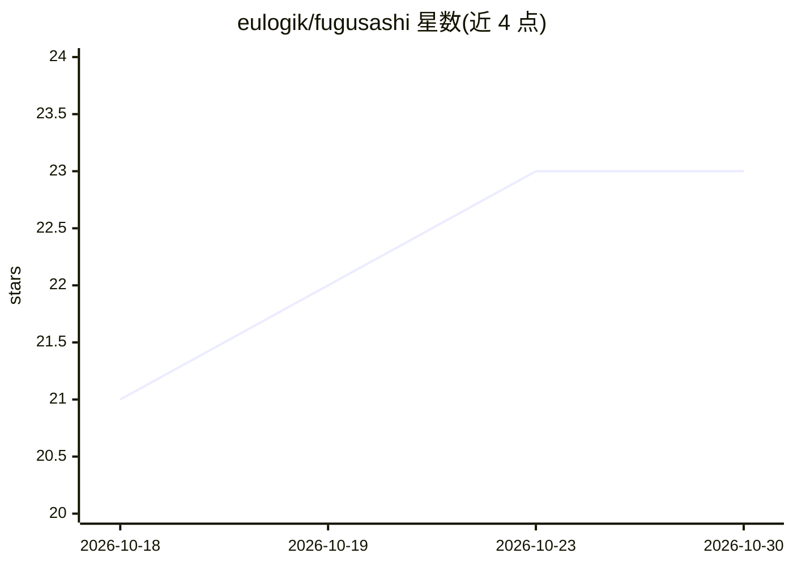

# eulogik/fugusashi

⭐ 23 · Python · MIT · 推送 2026-08-06 · [GitHub](https://github.com/eulogik/fugusashi) · [官网](https://eulogik.github.io/fugusashi/) · 个人维护

**自托管的 LLM 路由与多智能体编排引擎，可解释路由决策**

模型编排引擎：按 prompt 自动选择最合适的模型，通过 CMA-ES 演化权重与相似度反馈环持续学习路由策略；每个路由决策附带自然语言解释与置信度。提供 OpenAI 兼容 API、多智能体任务分解编排（GRPO 式学习）、多组织联邦路由学习（差分隐私、不共享数据）、结果数据集与实时可视化 Dashboard。以 pip 包、Docker 镜像或源码部署，自称为 Sakana AI Fugu 的开源替代。基准数字基于 20-30 条样本的初步评估。

## 筛选速览

| 维度 | 判定 | 备注 |
|---|---|---|
| AI 角色 | `ai-ecosystem` | LLM/agent 周边工具 |
| 许可风险 | `permissive` | MIT |
| 部署形态 | `self-host` | docker 或自建部署 |
| 模型依赖 | — | README 未给出锁定关系 |
| 硬件要求 | — | 无带数字的原话,不猜 |
| 安装摩擦 | `low` | 无编译、无系统依赖或容器化 |
| 成熟度 | `idea` | |

## 能力要点

- 三级路由策略（相似度/成本/兜底）+ 每请求反馈自动重训
- 每个路由决策输出自然语言解释、置信度与备选模型
- 多组织联邦路由学习，本地训练加差分隐私噪声后共享权重
- OpenAI 兼容 API 与 3 秒自动刷新的实时路由 Dashboard

## 适用场景

- 在自有基础设施上统一调度 100+ 模型提供商并优化成本
- 多机构协作改进路由效果而不共享 prompt 数据
- 需要审计与解释每次模型选择理由的团队

## 场景标签

`多智能体` `模型网关` · 领域:Agent 开发

## 证据(README 行号)

> L16: *Fugusashi* (Japanese: 不縛 — "unbound, unrestrained") is an intelligent model orchestration engine and multi-agent o
> L130: ### Tier 1 — Intelligent Model Router
> L140: A planning model that decomposes hard tasks into subtasks, assigns them to specialist models, and synthesizes resu

## 星数曲线

2026-10-18 21 → 2026-10-30 23（+2）

---
*卡片 v1 · prompt 1.4 · 生成 2026-10-27 · 置信度 high · 依据 README sha `1d5667e787f8` · [字段定义](../../DATASET.md)*
