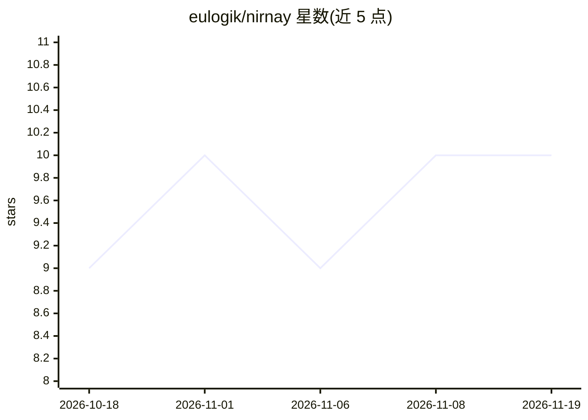

# eulogik/nirnay

⭐ 10 · Python · Apache-2.0 · 推送 2026-11-16 · [GitHub](https://github.com/eulogik/nirnay) · [官网](https://eulogik.com) · 组织维护

**450M 开放权重分类模型：银行意图识别与类型化决策**

基于 Laya 421M 的 Apache-2.0 分类器，单次前向将状态与问题映射为校准概率，不生成文本、不调用 API。提供概念瓶颈、粗到细指针与 RLCD 等训练机制，一次 checkpoint 下载后离线运行。附 pip 包、CLI（classify/fit/serve）与 Jev 兼容的本地服务端，支持用自有标签数据微调，512 token 上下文为明确限制。

## 筛选速览

| 维度 | 判定 | 备注 |
|---|---|---|
| AI 角色 | `ai-native` | 本体是模型或模型工具 |
| 许可风险 | `permissive` | Apache-2.0 |
| 部署形态 | `library` | 以包/库形式分发 |
| 模型依赖 | — | README 未给出锁定关系 |
| 硬件要求 | — | 无带数字的原话,不猜 |
| 安装摩擦 | `low` | 无编译、无系统依赖或容器化 |
| 成熟度 | — | 结构信号不足 |

## 能力要点

- Banking77 测试集 87.9% 准确率，fitted ECE 0.045
- pip 安装后本地离线运行，支持 MPS 与 CPU 推理
- nirnay fit 命令用自有 jsonl 数据微调并输出校准温度
- nirnay serve 提供与 Jev 兼容的 HTTP 接口

## 适用场景

- 银行客服工单的意图分类与分流路由
- 在自有标签集上微调并在笔记本上跑分类
- 低置信度结果标记转人工的守门场景

## 场景标签

`微调` · 领域:训练与推理

## 证据(README 行号)

> L10: **NIRNAY (निर्णय, "decision") is a 450M open-weight classifier for banking intent and typed decisions.** One forwar
> L172: **What is NIRNAY?** A 450M Apache-2.0 decision model: state plus typed question in, calibrated probabilities out. 

## 星数曲线

2026-10-18 9 → 2026-11-19 10（+1）

---
*卡片 v1 · prompt 1.4 · 生成 2026-11-19 · 置信度 high · 依据 README sha `09cc8b9ef5ac` · [字段定义](../../DATASET.md)*
