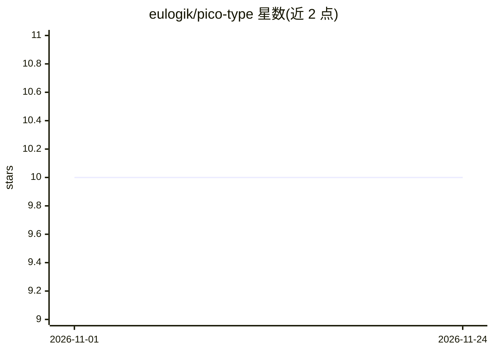

# eulogik/pico-type

⭐ 10 · Python · Apache-2.0 · 推送 2026-09-26 · [GitHub](https://github.com/eulogik/pico-type) · [官网](https://eulogik.github.io/pico-type/) · 组织维护

**对开发者：从原始字节分类内容类型、语言与敏感信息的轻量模型**

字节级多头内容分类器，单次前向输出 7 个头的结果：粗类型、模态、子类型、62 种代码语言、30 种文本语言、90 种 MIME、6 类风险标记（api_key/jwt/密码/邮箱/电话/ssh_key），无需分词器，直接读取原始 UTF-8 字节。以 PyPI 包提供 CLI、Python API、Gradio Space 与 MCP server 四种使用方式；提供 4 档 Matryoshka 尺寸（16d–576d）。README 明确限制：它是字节模式风险标记器，不是通用文本分类器；部分代码语言（javascript/scala 等）在当前训练数据下准确率低于 50%。Apache 2.0 许可。

## 筛选速览

| 维度 | 判定 | 备注 |
|---|---|---|
| AI 角色 | `ai-native` | 本体是模型或模型工具 |
| 许可风险 | `permissive` | Apache-2.0 |
| 部署形态 | `self-host` | docker 或自建部署 |
| 模型依赖 | — | README 未给出锁定关系 |
| 硬件要求 | — | 无带数字的原话,不猜 |
| 安装摩擦 | `low` | 无编译、无系统依赖或容器化 |
| 成熟度 | — | 结构信号不足 |

## 能力要点

- 7 个分类头一次前向：类型/模态/子类型/代码语言/文本语言/MIME/风险
- 直接读取原始字节，无需分词器与预处理
- 单文件 ONNX（FP32 约 9MB，图仅导出约 203KB），支持 CPU/浏览器/边缘部署
- 提供 CLI、Python API、Gradio Space、MCP server

## 适用场景

- 对剪贴板或文件内容做类型与 MIME 识别
- 扫描代码/配置中的密钥、密码等敏感信息标记
- 在浏览器或边缘设备上离线运行内容分类
- 通过 MCP server 在 Claude Desktop/Cursor 中调用分类能力

## 场景标签

`网络安全` · 领域:学习与行业

## 证据(README 行号)

> L3: **A tiny byte-level multi-head content classifier** — ~1.5M params, ~9MB single-file ONNX (FP32), ~18ms CPU inferenc
> L18: - **7 heads, one forward pass** — coarse type, modality, subtype, code language, text language, file MIME, risk fla

## 星数曲线

2026-11-01 10 → 2026-11-24 10（+0）

---
*卡片 v1 · prompt 1.4 · 生成 2026-11-19 · 置信度 mid · 依据 README sha `f80e701f764f` · [字段定义](../../DATASET.md)*
