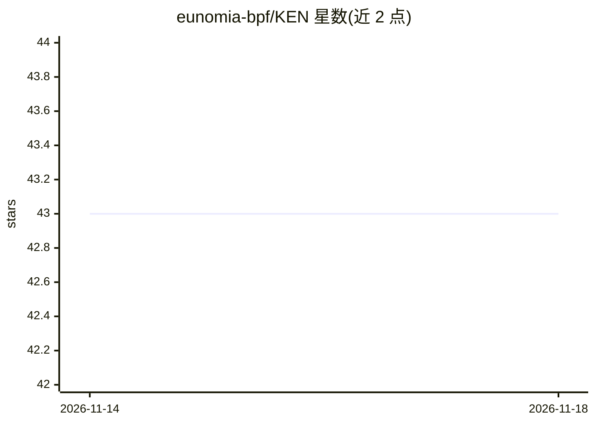

# eunomia-bpf/KEN

⭐ 43 · C · MIT · 推送 2026-11-14 · [GitHub](https://github.com/eunomia-bpf/KEN) · [官网](https://eunomia.dev/blogs/kgent/) · 组织维护

**用 LLM 将自然语言转成 eBPF 程序的研究 agent**

论文配套代码与评测脚本：通过大模型 agent 将自然语言描述翻译为 eBPF 程序，结合程序理解、符号执行与反馈循环保证语义等价，并在评测中报告相对 GPT-4 的正确率提升。面向系统管理员、DevOps、内核开发者与研究者，用于降低 eBPF 编写门槛。作者声明本仓库仅用于论文评测，更可用的工具见 GPTtrace。

## 筛选速览

| 维度 | 判定 | 备注 |
|---|---|---|
| AI 角色 | `ai-native` | 本体是模型或模型工具 |
| 许可风险 | `permissive` | MIT |
| 部署形态 | `None` |  |
| 模型依赖 | — | README 未给出锁定关系 |
| 硬件要求 | — | 无带数字的原话,不猜 |
| 安装摩擦 | `low` | 无编译、无系统依赖或容器化 |
| 成熟度 | — | 结构信号不足 |

## 能力要点

- 自然语言转 eBPF 程序
- 结合程序理解、符号执行与反馈循环保证语义等价
- 报告相对 GPT-4 的 2.67x 正确率提升

## 适用场景

- 系统管理员无需深入内核知识即可生成 eBPF 程序
- 内核开发者快速原型验证内核扩展
- 研究者探索自然语言驱动的内核编程

## 场景标签

`代码生成` `科研工具` · 领域:编码与开发

## 证据(README 行号)

> L3: This repository contains the code and evaluation for the paper Kgent: Kernel Extensions Large Language Model Agent.
> L11: - **Natural Language to eBPF**: Translates user prompts in natural language to eBPF programs.

## 星数曲线

2026-11-14 43 → 2026-11-18 43（+0）

---
*卡片 v1 · prompt 1.4 · 生成 2026-11-18 · 置信度 high · 依据 README sha `3e059c6cd575` · [字段定义](../../DATASET.md)*
