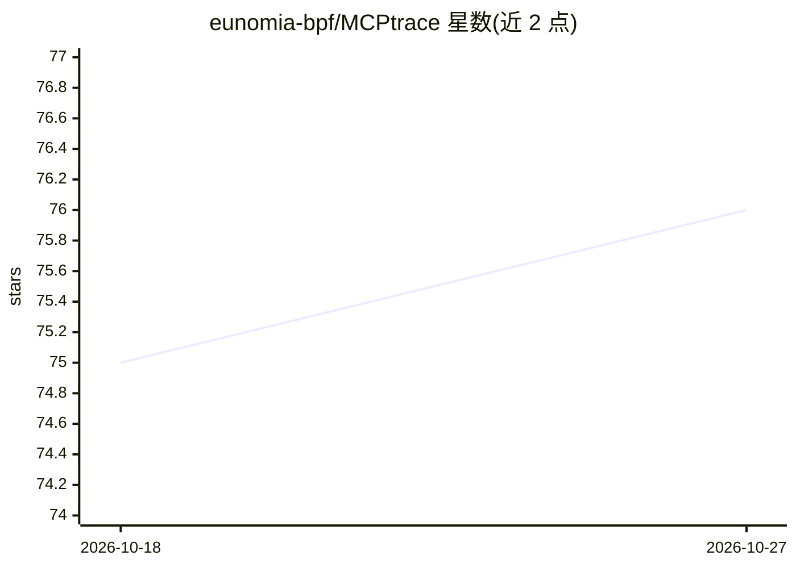

# eunomia-bpf/MCPtrace

⭐ 76 · Python · MIT · 推送 2026-02-12 · [GitHub](https://github.com/eunomia-bpf/MCPtrace) · 个人维护

**MCP 服务器：让 AI 助手通过 bpftrace 追踪 Linux 内核**

用 Rust 编写的 MCP (Model Context Protocol) 服务器，把 bpftrace 的内核追踪能力以工具接口形式提供给 AI 助手：可列出与搜索内核探针、查询内核追踪能力、执行 bpftrace 脚本并异步取回结果，附带生产可用的示例脚本集合。AI 不直接获得 root 权限，服务器作为安全网关经 sudo 执行 bpftrace；限制包括无脚本校验、无实时流式输出、60 秒最大执行时长。通过 cargo install 或源码构建安装，提供 Claude Desktop / Claude Code 的自动化配置脚本。

## 筛选速览

| 维度 | 判定 | 备注 |
|---|---|---|
| AI 角色 | `ai-ecosystem` | LLM/agent 周边工具 |
| 许可风险 | `permissive` | MIT |
| 部署形态 | `library` | 以包/库形式分发 |
| 模型依赖 | locked-api |  |
| 硬件要求 | — | 无带数字的原话,不猜 |
| 安装摩擦 | `medium` | 含编译或系统依赖之一 |
| 成熟度 | — | 结构信号不足 |

## 能力要点

- 列出/搜索内核探针与查询内核追踪能力（helpers、map types、probe types）
- 异步执行 bpftrace 脚本并轮询取回结果
- AI 不直接获得 root 权限，经网关以 sudo 执行
- 附生产级 bpftrace 示例脚本集合

## 适用场景

- 让 AI 助手用自然语言帮我生成并运行内核追踪脚本
- 排查偶发的生产环境内核/系统问题
- 在不掌握 eBPF 专业知识的情况下了解内核内部行为

## 场景标签

 · 领域:系统可观测性/MCP 工具

## 证据(README 行号)

> L1: # bpftrace MCP Server: generate eBPF to trace linux kernel
> L3: A minimal MCP (Model Context Protocol) server that provides AI assistants with access to bpftrace kernel tracing cap
> L14: - **Secure Execution Model**: Run kernel traces safely without giving AI direct root access - MCPtrace acts as a se

## 星数曲线

2026-10-18 75 → 2026-10-27 76（+1）

---
*卡片 v1 · prompt 1.4 · 生成 2026-10-24 · 置信度 high · 依据 README sha `94ee136bc30b` · [字段定义](../../DATASET.md)*
